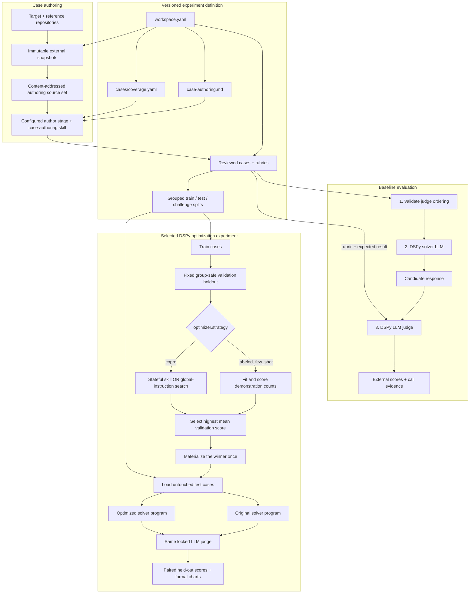

# MS Agent Eval

MS Agent Eval is a Python 3.12+ DSPy evaluation framework for arbitrary source
repositories. A repository URL/ref and its instruction paths are configuration;
the evaluated project is never a dependency of this library.

The framework has no built-in target repository. Each experiment workspace
independently selects its repository, immutable revision, instruction sources,
cases, rubrics, and models.

## Technology at a glance

| Technology | How it is used |
|---|---|
| Python 3.12+ and Rich | Framework implementation and a live `ms-agent-eval` terminal interface with explicit JSON automation output. |
| Portable stages | Authoring, judge validation, fitting, solving, judging, model selection, and aggregation use one immutable packet/result lifecycle. |
| Codex skills / CLI | The configured author model creates grounded cases; the isolated CLI adapter can execute model-driven stages with subscription authentication in disposable containers. |
| DSPy 3.2 | The runtime prompt-programming layer. Typed programs define optimizer, solver, and judge calls. A named optimization experiment chooses labeled few-shot fitting or one factorized COPRO search over skills or global instructions. |
| OpenAI-compatible APIs | Endpoint transport for model-driven DSPy stages. Solver and judge remain separate roles but may use the same model. |
| OpenRouter model catalog | Static, upsert-only reference data for model context, capabilities, and raw plus $/million-token pricing, with deterministic matching for local model names. |
| YAML / PyYAML | Human-readable workspace configuration, case metadata, rubrics, split assignments, and judge-validation manifests. |
| Git | Resolves the target and optional reference repositories from tags or commits into immutable snapshots with recorded provenance. |
| Docker | Digest-pinned isolation for automatic Codex CLI stages, with stage-specific read-only views and a restricted control-plane proxy. |
| SHA-256 + JSON artifacts | Identifies snapshots, programs, inputs, calls, and results so runs are reproducible and auditable. |
| External filesystem storage | Keeps snapshots, model-call evidence, compiled DSPy programs, runs, and reports under `~/ms_agent_eval/<workspace-id>` instead of committing them. |
| MLflow 3.16 | Optional recorder adapter for run comparison, metrics, tables, traces, graphs, and artifacts. Local evidence remains authoritative and outages are retryable. |
| Plotly 7 | Interactive MLflow chart artifacts with hover, zoom, selection, series toggles, and client-side SVG export; deterministic SVG companions remain available for static reports. |
| `uv`, Hatchling, pytest, Ruff | Dependency/environment management, package builds, tests, and linting. |

The target repository is data, not a Python dependency of the framework. The
framework snapshots it, loads only the configured instructions and cases, asks
the runtime LLMs to solve and judge, and writes all mutable evidence outside
both repositories. Codex authors cases directly before runtime evaluation.

## How an experiment runs

Every scored workflow separates authoring, solver, and judge roles through
portable stages. The roles may share a model only when the workspace explicitly
configures that choice:



- Codex first decomposes every complete selected skill into the versioned
  `cases/coverage.yaml` capability catalog, then combines the versioned
  `case-authoring.md` policy with locked target and
  reference-repository snapshots. It writes reviewed case packages directly to
  the case bank, with source/policy/catalog/content hashes. Each case has one
  primary capability; readiness requires every catalog capability to reach its
  configured primary-case depth. This step requires no model
  endpoint. Diagnostic cases give substantial rubric weight to correctly
  identifying a real error instead of blindly following a faulty premise.
- The solver sees the task and locked instruction context, never the rubric or
  expected result.
- The LLM judge is the only semantic scorer. Framework code only validates its
  typed result, aggregates votes, and computes weighted arithmetic.
- Optimization compares candidates on one fixed, group-safe validation holdout
  derived from permanent train. A
  `labeled_few_shot` experiment changes only demonstrations; a `copro`
  experiment keeps zero demonstrations and searches either selected skill
  overlays with `AGENTS.md` frozen or one global instruction bundle with every
  skill frozen. The DSPy signature stays frozen in both modes. COPRO carries
  each winning bundle and the complete scored candidate history into the next
  search round, including per-case criterion scores, hard failures, and judge
  feedback. Before dispatch, exact endpoint tokenization reserves room for the
  uncapped rewritten candidates. Only a request that exceeds every eligible model
  context is retried with deterministic structural deltas for non-selected text;
  its score and failure evidence remain intact. COPRO does not restart per fold or
  perform another final search. It has no numerical acceptance cutoff, permanent
  validation split, or test-access gate. After selection, a
  COPRO run compares the original and optimized programs on every identical
  untouched test case and records the signed delta by skill, criterion, and
  exact expected-response token length.

There is no raw prompt engine, deterministic evaluator plugin, legacy reader,
or user-facing engine selector.

See [Formal COPRO summary](docs/evaluation/formal-copro-summary.md) for the
paired metrics, exact expected-response token bands, and complete local/MLflow
asset inventory.

## Install

DSPy is a required base dependency:

```bash
uv sync --python 3.12
uv run ms-agent-eval --help
```

Install the MLflow recorder and server support when experiment tracking is
enabled:

```bash
uv sync --python 3.12 --extra mlflow
```

## Create a workspace

Use the guided setup to inspect the repository and select its instructions and
skills interactively. The same flow configures the direct API/model values,
runtime, repetitions, initial case coverage, and optional optimization:

```bash
uv run ms-agent-eval setup
```

For automation and CI, provide the complete configuration explicitly:

```bash
uv run ms-agent-eval init \
  --id example-evaluation \
  --repo https://github.com/example/project \
  --ref v1.2.3 \
  --global-instructions AGENTS.md \
  --skills-directory .agents/skills \
  --cases cases \
  --endpoint llama-cpp-17-18081 http://192.168.1.17:18081/v1 2 \
  --endpoint llama-cpp-17-18080 http://192.168.1.17:18080/v1 2 \
  --endpoint llama-server-10-11434 http://192.168.1.10:11434/v1 4 \
  --solver-model solver-model \
  --solver-deployment-revision solver-deployment-v1 \
  --solver-reasoning-effort high \
  --judge-model judge-model \
  --judge-deployment-revision judge-deployment-v1 \
  --judge-reasoning-effort none \
  --mlflow-tracking-uri http://127.0.0.1:5000 \
  --recording-content-policy full
```

The generated schema-v17 `workspace.yaml` has these top-level concerns:

1. `recording`, `recorders`, and `recorder_queues`: optional projection policy,
   external destinations, and durable managed delivery.
2. `executors`, `deployments`, and `models`: transport routes, immutable served
   model revisions, and role-specific inference profiles.
3. `stages`: portable reuse and budget policies; experiment arms select models.
4. `evaluation`: repository, global instructions, exactly one skill selection,
   case-authoring policy/sources, case directory, split policy, and LLM judge.
5. `experiments` and `comparisons`: solver/optimizer/judge arms, DSPy strategy,
   and explicit cross-model reporting groups.

Use `skills.files` instead of `skills.directory` when evaluating only an exact
list of `SKILL.md` files. Both-or-neither is rejected.

Optional tutorials, real projects, and separately versioned contract sources
belong under `evaluation.case_authoring.sources`. Each URL/ref is independently
snapshotted outside Git; selected paths reach Codex under
`references/<source-id>/...` and participate in one combined provenance hash.

Case-bank readiness is also workspace configuration. New workspaces default to
at least eight reviewed cases and four distinct leakage groups per skill:

```yaml
evaluation:
  cases:
    directory: cases
    coverage:
      catalog: cases/coverage.yaml
      minimum_cases_per_skill: 8
      minimum_leakage_groups_per_skill: 4
```

The generated catalog starts as `draft`. Codex must read every selected skill,
record all independently testable capabilities, and mark it `complete` before
scored-run readiness. Requested case counts are lower bounds; the authoring
campaign expands until every capability has its required primary examples.
Every new workspace also includes `cases/README.md`, which explains this
contract beside the catalog. See the general
[capability coverage contract](docs/evaluation/capability-coverage.md) for the complete
schema, readiness calculation, authoring procedure, and provenance rules.

## Configure deployments, role profiles, and experiment arms

Endpoint pools are transport. Deployments say which model is actually served
where. Model profiles add role-specific inference settings, and each experiment
arm chooses its solver, optimizer, and judge profiles independently:

```yaml
executors:
  lan-inference:
    type: endpoint
    adapter: openai_compatible
    endpoints:
      - id: llama-cpp-17-18081
        base_url: http://192.168.1.17:18081/v1
        max_concurrent_requests: 2
        routes:
          - {deployment: qwen-27b-local, model: qwen3.6:27b-coding}
      - id: llama-cpp-17-18080
        base_url: http://192.168.1.17:18080/v1
        max_concurrent_requests: 2
        routes:
          - {deployment: glm-local, model: glm-coding}
      - id: llama-server-10-11434
        base_url: http://192.168.1.10:11434/v1
        max_concurrent_requests: 4
        routes:
          - {deployment: qwen-27b-local, model: qwen3.6:27b-coding}

deployments:
  qwen-27b-local:
    executor: lan-inference
    model: qwen3.6:27b-coding
    revision: qwen3.6-27b-coding-local-2026-09-14
  glm-local:
    executor: lan-inference
    model: glm-coding
    revision: glm-coding-local-2026-09-14

models:
  qwen-optimizer:
    deployment: qwen-27b-local
    reasoning_effort: none
    parameters: {temperature: 0.7}
  qwen-solver:
    deployment: qwen-27b-local
    reasoning_effort: high
    parameters: {temperature: 0.2}
  fixed-judge:
    deployment: qwen-27b-local
    reasoning_effort: none
    parameters: {temperature: 0.0}

stages:
  optimize:
    reuse: {policy: exact}
    budget: {model_calls: 1, tokens: 32000, wall_seconds: 600}
  solve:
    reuse: {policy: exact}
    budget: {model_calls: 1, tokens: 32000, wall_seconds: 600}
  judge:
    reuse: {policy: exact}
    budget: {model_calls: 1, tokens: 64000, wall_seconds: 600}

experiments:
  qwen-baseline:
    mode: evaluate
    roles: {solver: qwen-solver, judge: fixed-judge}
    # solver, runtime, and repetitions follow here
  qwen-copro:
    mode: optimize
    based_on: qwen-baseline
    roles:
      solver: qwen-solver
      optimizer: qwen-optimizer
      judge: fixed-judge
    # optimizer, validation, and budget follow here
```

The coordinator runs ready packets through a bounded local thread pool. Each
endpoint enforces one physical request limit shared by all of its routes. A
Qwen-driven stage has six eligible slots in this example (2 + 4); it cannot use
the two GLM-only slots. `deployments.<id>.revision` is the explicit semantic
cache boundary for weights, quantization, tokenizer, template, and serving
behavior.

Judge validation uses that same pool at request granularity. One judge vote is
the default: five fixtures produce five concurrent-ready votes, bounded by the
fixed judge deployment's eligible capacity. Additional repetitions are an
explicit robustness option and are followed by deterministic median/majority
aggregation. The terminal reports every completed vote and its selected endpoint.

Only credentials remain process-local. When a provider requires a key, add
`api_key_env: OPENAI_API_KEY` to that endpoint item and define that secret in
the ignored `.env` file. Runtime state defaults to
`~/ms_agent_eval/<workspace-id>`; `workspace.data_root` may explicitly select
another external path.

Every stage is content-addressed. `exact` reuses a previously validated result
with the same semantic inputs, program, deployment, parameters, execution
environment, and output contract. `refresh` deliberately executes again.
`replicate` is available for solver variance studies and requires an explicit
sample count. A model alias is not a safe cache boundary, so the selected
`deployments.<id>.revision` must change whenever local weights, quantization,
tokenizer, chat template, or serving behavior changes. See
[Incremental execution and reuse](docs/execution/incremental-execution.md).
Endpoint topology, scheduling, and provenance are documented in
[Pooled endpoint execution](docs/execution/openai-compatible-api.md).

Starting a run also freezes its selected workspace configuration and every
loaded case, split, judge-validation, catalog, policy, and source-snapshot identity
into an immutable revision bundle. `run resume <run-id>` always continues that
stored revision—even after relevant workspace edits—while `run baseline`
compiles the edited workspace as a new revision and reuses only compatible work.

## Full flow

```bash
uv run ms-agent-eval validate --workspace workspace.yaml
# Ask Codex to use the case-authoring skill with this workspace and campaign goal.
uv run ms-agent-eval inspect --workspace workspace.yaml
# Render the real DSPy requests and check native token fit/capacity without generation.
uv run ms-agent-eval preflight baseline --workspace workspace.yaml
# When recording is enabled, verify its configured destination before spending model capacity.
uv run --extra mlflow ms-agent-eval recorder doctor --workspace workspace.yaml
# While coverage is incomplete, exercise judge validation, solving, and judging on
# train cases without producing benchmark metrics.
uv run ms-agent-eval run baseline --pilot --workspace workspace.yaml
# After validation reports ready_for_scored_run: true:
uv run ms-agent-eval run baseline --workspace workspace.yaml
uv run ms-agent-eval run optimize-solver --workspace workspace.yaml
```

`optimize-solver` is only an example experiment id. Its `optimizer.strategy`
is the authority: `labeled_few_shot` evaluates `k` demonstrations and makes no
optimizer-model calls, while `copro` runs explicit optimize → candidate
solve/judge → select rounds and compiles a zero-shot artifact for exactly one
configured instruction layer.

`preflight` makes zero generation calls and creates no run or result artifacts.
Before the token diagnostics, it expands the complete experiment workload: all
permanent and derived case sets, one-time judge calibration, optimization
targets, rounds, candidates, validation solves/judgments, final test
arms, local fit/select work, model routes, endpoint slots, and the fresh-run
model-call upper bound by role. The upper bound is explicitly before semantic
cache reuse; exact reuse is resolved only when packets are materialized. It then
shows exact-fit and dispatchable parallel capacity, endpoint context windows,
largest rendered request, and minimum dispatch waves. Judge requests are
reported as deferred until their solver responses exist because candidate
response size is part of the real judge request. `run` repeats the expanded
case/call/search summary before its first model-driven stage.

A pilot is immutable and explicitly records `benchmark_valid: false`. It never
loads test or challenge cases, cannot run optimization, retains per-case judge
diagnostics, uses one diagnostic judge vote per fixture/case, and omits
aggregate mean-score fields. Resume or operate its packets with
the same `--pilot` flag.

Every full run is resumable orchestration over the same public stage commands:

```bash
uv run ms-agent-eval run baseline --through solve --workspace workspace.yaml
uv run ms-agent-eval stage list --run <run-id> --workspace workspace.yaml
uv run ms-agent-eval run resume <run-id> --workspace workspace.yaml
```

For an external harness, prepare or claim a packet and submit a JSON result with
`stage prepare`, `stage claim`, and `stage submit`. Packet, result, transition,
model, executor, and usage evidence is append-only under the external data root.

When `recording.enabled` is true, each durable checkpoint appends a small queue
intent. The normal `run` command automatically starts one run-scoped recorder
consumer, publishes live progress, and drains final recording work. No second
command is required. The standalone `recorder worker` and `recorder project`
commands exist only for recovery, backfill, or separately deployed consumers.
A tracking outage never invalidates the evaluation; see
[Experiment recording with MLflow](docs/execution/experiment-recording.md).

Generated snapshots, solver calls, judge calls, compiled
state, results, and reports remain outside Git. Only `workspace.yaml`, reviewed
case packages, `case-authoring.md`, split assignments, and reviewed
reference-labelled judge validation inputs are versioned. The Codex
case-authoring campaign creates the cases, grouped splits, and judge-validation
fixtures together; judge validation is not a later manual phase.

Ask Codex for narrow campaigns covering different capabilities, sources,
difficulties, and archetypes until `validate` reports that every skill satisfies the configured
case and leakage-group minima. Those minima prevent a one-case-per-skill bank
from being treated as evaluation- or training-ready; they remain a floor, not a
guarantee of enough data for a production fine-tune.

Start with the [documentation map](docs/index.md) or jump directly to
[Getting started](docs/experiments/getting-started.md). The task-oriented guides
separate [experiment setup](docs/experiments/index.md),
[training and optimization](docs/training/index.md),
[evaluation](docs/evaluation/index.md), and
[execution](docs/execution/index.md).

## Storage layout

There are two locations with different ownership. The Git repository contains
reusable code and reviewable experiment definitions:

```text
repository/
├── .agents/skills/             framework authoring workflows
├── src/ms_agent_eval/          repository-agnostic library and CLI
├── experiments/
│   └── <workspace>/
│       ├── workspace.yaml      target, instructions, cases, models, runtime
│       ├── case-authoring.md   versioned Codex authoring policy
│       ├── .env.example        optional credential-name template
│       ├── cases/              coverage contract, reviewed cases, and splits
│       └── judge-validation/  authored and reviewed judge fixtures
├── tests/                      generic framework acceptance tests
├── docs/                       general guides and architecture records
└── .implementation_tasks/      local ignored implementation plans
```

Mutable and generated data belongs outside Git under the workspace data root:

```text
~/ms_agent_eval/<workspace-id>/
├── operations/                 internal, machine-oriented execution data
│   ├── snapshots/              immutable target and reference snapshots
│   ├── blobs/sha256/           content-addressed responses, traces, and state
│   ├── manifests/              locks, model calls, runs, and scores
│   ├── recorders/              outbox, external bindings, receipts, and errors
│   └── tmp/                    atomic staging
└── summary/runs/<run-id>/
    ├── index.html              local human entry point
    ├── summary.md              deterministic run overview
    ├── results.csv             one row per judged case repetition
    ├── results.json            canonical derived report
    ├── cases/                  readable per-case evidence
    ├── graphs/                 Plotly HTML, SVG, DAG, and chart guide
    └── tables/                 sortable browser plus CSV/JSON tables
```

Every terminal experiment creates this report bundle automatically, without an
LLM summarization call. Existing runs can be rendered again with
`ms-agent-eval report build --run <run-id> --workspace <workspace.yaml>`.
Open `summary/runs/<run-id>/index.html` directly to browse the local report.
Operational charts are materialized for failed and cancelled runs too; final
baseline-versus-optimized charts appear only after the paired test aggregate exists.

There is no root-level `cases/`, `sdk/`, or `runs/` directory. Cases belong to
their experiment workspace; repository snapshots and every generated run
artifact belong to the external data root. Adding a target means adding a new
workspace, not changing `src/ms_agent_eval` or copying an SDK into this repo.

## Verify

```bash
uv run ruff check src tests
uv run pytest
uv lock --check
uv build
```
