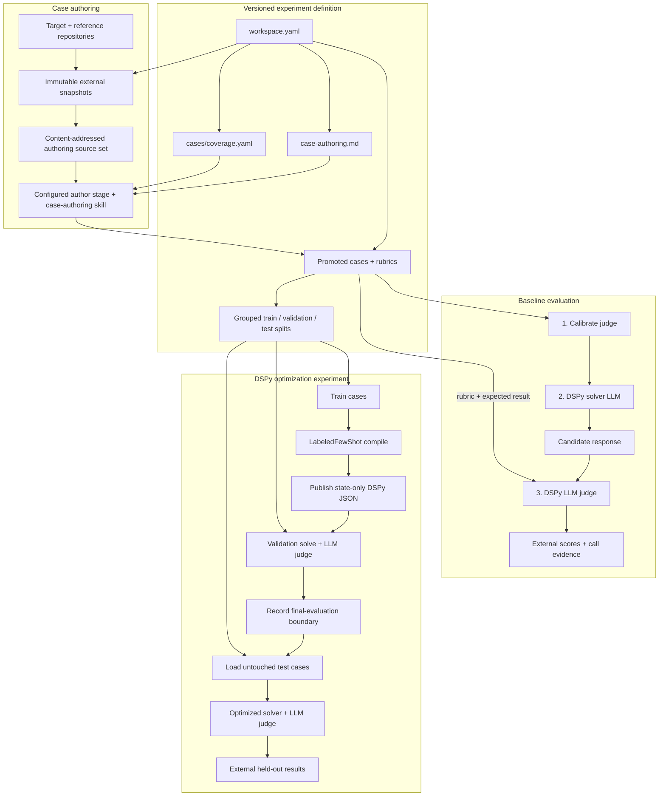

# MS Agent Eval

MS Agent Eval is a Python 3.12+ DSPy evaluation framework for arbitrary source
repositories. A repository URL/ref and its instruction paths are configuration;
the evaluated project is never a dependency of this library.

The framework has no built-in target repository. Each experiment workspace
independently selects its repository, immutable revision, instruction sources,
cases, rubrics, and models.

## Technology at a glance

| Technology | How it is used |
|---|---|
| Python 3.12+ and Rich | Framework implementation and a live `ms-agent-eval` terminal interface with explicit JSON automation output. |
| Portable stages | Authoring, calibration, solving, judging, optimization, final evaluation, and aggregation use one immutable packet/result lifecycle. |
| Codex skills / CLI | The configured author model creates grounded cases; the isolated CLI adapter can execute model-driven stages with subscription authentication in disposable containers. |
| DSPy 3.2 | The runtime prompt-programming layer. Typed DSPy signatures define the solver and judge; `LabeledFewShot` compiles optimized solver state. |
| OpenAI-compatible APIs | Endpoint transport for model-driven DSPy stages. Solver and judge remain separate roles but may use the same model. |
| YAML / PyYAML | Human-readable workspace configuration, case metadata, rubrics, split assignments, and judge-calibration manifests. |
| Git | Resolves the target and optional reference repositories from tags or commits into immutable snapshots with recorded provenance. |
| Docker | Digest-pinned isolation for automatic Codex CLI stages, with stage-specific read-only views and a restricted control-plane proxy. |
| SHA-256 + JSON artifacts | Identifies snapshots, programs, inputs, calls, and results so runs are reproducible and auditable. |
| External filesystem storage | Keeps snapshots, model-call evidence, compiled DSPy programs, runs, and reports under `~/ms_agent_eval/<workspace-id>` instead of committing them. |
| `uv`, Hatchling, pytest, Ruff | Dependency/environment management, package builds, tests, and linting. |

The target repository is data, not a Python dependency of the framework. The
framework snapshots it, loads only the configured instructions and cases, asks
the runtime LLMs to solve and judge, and writes all mutable evidence outside
both repositories. Codex authors cases directly before runtime evaluation.

## How an experiment runs

Every scored workflow separates authoring, solver, and judge roles through
portable stages. The roles may share a model only when the workspace explicitly
configures that choice:



- Codex first decomposes every complete selected skill into the versioned
  `cases/coverage.yaml` capability catalog, then combines the versioned
  `case-authoring.md` policy with locked target and
  reference-repository snapshots. It writes reviewed case packages directly to
  the case bank, with source/policy/catalog/content hashes. Each case has one
  primary capability; readiness requires every catalog capability to reach its
  configured primary-case depth. This step requires no model
  endpoint. Diagnostic cases give substantial rubric weight to correctly
  identifying a real error instead of blindly following a faulty premise.
- The solver sees the task and locked instruction context, never the rubric or
  expected result.
- The LLM judge is the only semantic scorer. Framework code only validates its
  typed result, aggregates votes, and computes weighted arithmetic.

There is no raw prompt engine, deterministic evaluator plugin, legacy reader,
or user-facing engine selector.

## Install

DSPy is a required base dependency:

```bash
uv sync --python 3.12
uv run ms-agent-eval --help
```

## Create a workspace

Use the guided setup to inspect the repository and select its instructions and
skills interactively. The same flow configures the direct API/model values,
runtime, repetitions, initial case coverage, and optional optimization:

```bash
uv run ms-agent-eval setup
```

For automation and CI, provide the complete configuration explicitly:

```bash
uv run ms-agent-eval init \
  --id example-evaluation \
  --repo https://github.com/example/project \
  --ref v1.2.3 \
  --global-instructions AGENTS.md \
  --skills-directory .agents/skills \
  --cases cases \
  --api-base-url http://127.0.0.1:8000/v1 \
  --solver-model solver-model \
  --solver-deployment-revision solver-deployment-v1 \
  --solver-reasoning-effort high \
  --judge-model judge-model \
  --judge-deployment-revision judge-deployment-v1 \
  --judge-reasoning-effort none
```

The generated schema-v9 `workspace.yaml` has these top-level concerns:

1. `executors` and `models`: reusable transport and model definitions.
2. `stages`: the executor, model, and budget assigned to each portable stage.
3. `evaluation`: repository, global instructions, exactly one skill selection,
   case-authoring policy/sources, case directory, split policy, and LLM judge.
4. `experiments`: solver program, runtime, normal evaluation, and optional DSPy
   optimization.

Use `skills.files` instead of `skills.directory` when evaluating only an exact
list of `SKILL.md` files. Both-or-neither is rejected.

Optional tutorials, real projects, and separately versioned contract sources
belong under `evaluation.case_authoring.sources`. Each URL/ref is independently
snapshotted outside Git; selected paths reach Codex under
`references/<source-id>/...` and participate in one combined provenance hash.

Case-bank readiness is also workspace configuration. New workspaces default to
at least eight promoted cases and four distinct leakage groups per skill:

```yaml
evaluation:
  cases:
    directory: cases
    coverage:
      catalog: cases/coverage.yaml
      minimum_cases_per_skill: 8
      minimum_leakage_groups_per_skill: 4
```

The generated catalog starts as `draft`. Codex must read every selected skill,
record all independently testable capabilities, and mark it `complete` before
scored-run readiness. Requested case counts are lower bounds; the authoring
campaign expands until every capability has its required primary examples.
Every new workspace also includes `cases/README.md`, which explains this
contract beside the catalog. See the general
[capability coverage contract](docs/evaluation/capability-coverage.md) for the complete
schema, readiness calculation, authoring procedure, and provenance rules.

## Configure executors, models, and stages

API locations and model names are separate durable configuration. Stages bind
one executor to an optional model:

```yaml
executors:
  remote-qwen:
    type: endpoint
    adapter: openai_compatible
    base_url: http://192.168.1.10:11434/v1

models:
  solver:
    name: qwen3.6:27b-coding
    deployment_revision: qwen3.6-27b-coding-local-2026-09-13
    reasoning_effort: high
    parameters: {temperature: 0.2}
  judge:
    name: qwen3.6:27b-coding
    deployment_revision: qwen3.6-27b-coding-local-2026-09-13
    reasoning_effort: none
    parameters: {temperature: 0.0}

stages:
  solve:
    executor: remote-qwen
    model: solver
    reuse: {policy: exact}
    budget: {model_calls: 1, tokens: 32000, wall_seconds: 600}
  judge:
    executor: remote-qwen
    model: judge
    reuse: {policy: exact}
    budget: {model_calls: 3, tokens: 64000, wall_seconds: 600}
```

Only credentials remain process-local. When a provider requires a key, add
`api_key_env: OPENAI_API_KEY` to the endpoint executor and define that secret
in the ignored `.env` file. Runtime state defaults to
`~/ms_agent_eval/<workspace-id>`; `workspace.data_root` may explicitly select
another external path.

Every stage is content-addressed. `exact` reuses a previously validated result
with the same semantic inputs, program, deployment, parameters, execution
environment, and output contract. `refresh` deliberately executes again.
`replicate` is available for solver variance studies and requires an explicit
sample count. A model alias is not a safe cache boundary, so
`deployment_revision` must change whenever local weights, quantization,
tokenizer, chat template, or serving behavior changes. See
[Incremental execution and reuse](docs/execution/incremental-execution.md).

Starting a run also freezes its selected workspace configuration and every
loaded case, split, calibration, catalog, policy, and source-snapshot identity
into an immutable revision bundle. `run resume <run-id>` always continues that
stored revision—even after relevant workspace edits—while `run baseline`
compiles the edited workspace as a new revision and reuses only compatible work.

## Full flow

```bash
uv run ms-agent-eval validate --workspace workspace.yaml
# Ask Codex to use the case-authoring skill with this workspace and campaign goal.
uv run ms-agent-eval inspect --workspace workspace.yaml
# While coverage is incomplete, exercise calibration, solving, and judging on
# train/validation cases without producing benchmark metrics.
uv run ms-agent-eval run baseline --pilot --workspace workspace.yaml
# After validation reports ready_for_scored_run: true:
uv run ms-agent-eval run baseline --workspace workspace.yaml
uv run ms-agent-eval run optimize-few-shot --workspace workspace.yaml
```

A pilot is immutable and explicitly records `benchmark_valid: false`. It never
loads test or challenge cases, cannot run optimization, retains per-case judge
diagnostics, uses one diagnostic judge vote per fixture/case, and omits
aggregate mean-score and pass-rate fields. Resume or operate its packets with
the same `--pilot` flag.

Every full run is resumable orchestration over the same public stage commands:

```bash
uv run ms-agent-eval run baseline --through solve --workspace workspace.yaml
uv run ms-agent-eval stage list --run <run-id> --workspace workspace.yaml
uv run ms-agent-eval run resume <run-id> --workspace workspace.yaml
```

For an external harness, prepare or claim a packet and submit a JSON result with
`stage prepare`, `stage claim`, and `stage submit`. Packet, result, transition,
model, executor, and usage evidence is append-only under the external data root.

Generated snapshots, solver calls, judge calls, compiled
state, results, and reports remain outside Git. Only `workspace.yaml`, promoted
case packages, `case-authoring.md`, split assignments, and reviewed
reference-labelled judge calibration inputs are versioned. The Codex
case-authoring campaign creates the cases, grouped splits, and calibration
fixtures together; calibration is not a later manual phase.

Ask Codex for narrow campaigns covering different capabilities, sources,
difficulties, and archetypes until `validate` reports that every skill satisfies the configured
case and leakage-group minima. Those minima prevent a one-case-per-skill bank
from being treated as evaluation- or training-ready; they remain a floor, not a
guarantee of enough data for a production fine-tune.

Start with the [documentation map](docs/index.md) or jump directly to
[Getting started](docs/experiments/getting-started.md). The task-oriented guides
separate [experiment setup](docs/experiments/index.md),
[training and optimization](docs/training/index.md),
[evaluation](docs/evaluation/index.md), and
[execution](docs/execution/index.md).

## Storage layout

There are two locations with different ownership. The Git repository contains
reusable code and reviewable experiment definitions:

```text
repository/
├── .agents/skills/             framework authoring workflows
├── src/ms_agent_eval/          repository-agnostic library and CLI
├── experiments/
│   └── <workspace>/
│       ├── workspace.yaml      target, instructions, cases, models, runtime
│       ├── case-authoring.md   versioned Codex authoring policy
│       ├── .env.example        optional credential-name template
│       ├── cases/              coverage contract, promoted cases, and splits
│       └── judge-calibration/  authored and reviewed judge fixtures
├── tests/                      generic framework acceptance tests
├── docs/                       general guides and architecture records
└── .implementation_tasks/      local ignored implementation plans
```

Mutable and generated data belongs outside Git under the workspace data root:

```text
~/ms_agent_eval/<workspace-id>/
├── operations/                 internal, machine-oriented execution data
│   ├── snapshots/              immutable target and reference snapshots
│   ├── blobs/sha256/           content-addressed responses, traces, and state
│   ├── manifests/              locks, model calls, runs, and scores
│   └── tmp/                    atomic staging
└── summary/runs/<run-id>/
    ├── summary.md              deterministic run overview
    ├── results.csv             one row per judged case repetition
    ├── results.json            canonical derived report
    └── cases/                  readable per-case evidence
```

Every terminal experiment creates this report bundle automatically, without an
LLM summarization call. Existing runs can be rendered again with
`ms-agent-eval report build --run <run-id> --workspace <workspace.yaml>`.

There is no root-level `cases/`, `sdk/`, or `runs/` directory. Cases belong to
their experiment workspace; repository snapshots and every generated run
artifact belong to the external data root. Adding a target means adding a new
workspace, not changing `src/ms_agent_eval` or copying an SDK into this repo.

## Verify

```bash
uv run ruff check src tests
uv run pytest
uv lock --check
uv build
```
