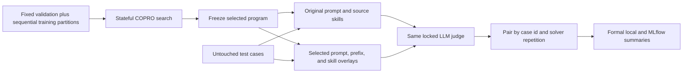

# ADR-008: Paired COPRO Evaluation and Formal Reporting

- Status: Accepted and implemented
- Date: 2026-09-14
- Scope: final COPRO test execution, response-length measurement, aggregate
  semantics, local reports, and MLflow projections
- Extends: [ADR-007](007-configurable-dspy-optimization-strategies.md)
- Preserves: [ADR-003](003-content-addressed-experiment-graph.md)
- Search lifecycle refined by:
  [ADR-011](011-stateful-optimization-and-semantic-reuse.md)

## Context

A COPRO search previously reported only the selected program's untouched-test
score. That shows absolute quality but does not measure the effect of the
optimization against the original prompt and skill text under the same test
conditions. The report also exposed subjective case labels such as `easy` and
`complex`, which are neither reproducible measurements nor suitable axes for a
formal experiment summary.

## Decision

After COPRO finishes model selection and freezes its final program, the
coordinator evaluates two test arms:

The baseline arm is scheduled after the final fit exists, but the fitted
program is not part of its model-visible input or reusable work identity. Both
arms use the same solver deployment, parameters, endpoint pool, cases,
repetitions, judge program, judge deployment, and rubrics. Test results cannot
feed back into search or selection.

The optimized program's mean remains the run's primary `mean_score`. The report
also records the baseline mean, optimized mean, paired micro delta, macro mean
skill delta, improved/regressed/unchanged skill counts, and a deterministic
95% cluster-bootstrap interval over leakage groups.

## Response-length measurement

Cases no longer contain `difficulty`. Schema-v6 accepts no such field. Response
length is measured automatically from the hidden expected response:

- the tokenizer is the exact `/tokenize` extension of the configured solver
  endpoint;
- the input is the expected-response text only;
- no chat template is applied;
- special tokens are disabled;
- no character or word approximation is accepted; and
- the count is produced only after solve and judge execution, so it never
  enters solver or optimizer packets.

Every count records the expected-response content hash, model and deployment
revision, executor and endpoint identity, endpoint-configuration hash, and
tokenizer fingerprint. Fixed bands are `1-128`, `129-256`, `257-512`,
`513-1024`, `1025-2048`, and `2049+`. These are descriptive response-length
bands, not semantic difficulty categories.

If no endpoint exposes exact tokenization, the benchmark still records its
scores. Token-dependent tables and charts are omitted with an explicit reason;
the framework never invents an approximate count.

## Formal chart rules

Charts use a white background, fixed score axes from zero to one, stable colors
for original and optimized programs, deterministic ordering, and explicit
signed deltas. The skill chart is ordered by optimization delta descending,
then by skill id. Tables remain the numerical source behind every chart.

The complete asset inventory and metric definitions are documented in
[Formal COPRO summaries](../evaluation/formal-copro-summary.md).

## Identity and reuse

The two solve arms have distinct content-derived work identities because their
effective program and skill context differ. Unchanged baseline work can be
reused across COPRO runs. Optimized work is reused only when the compiled
program and every other model-visible input are identical. Aggregate identity
includes both judgment-result sets and the exact token-measurement index.

## Consequences

- A COPRO run performs twice the number of final-test solver and judge calls.
- Preflight budget projections include both arms.
- A report fails integrity validation if a baseline/optimized pair is missing
  or duplicated.
- Local reports and MLflow show optimization lift without implying a pass/fail
  threshold.
- Historical runs remain readable through their frozen artifacts, but current
  code accepts only schema-v6 authored cases and run-summary/report schema v4.
