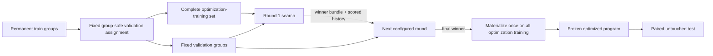

# ADR-011: Stateful Optimization and Semantic Work Reuse

- Status: Accepted
- Date: 2026-09-15
- Supersedes: ADR-007 sections that require independent K-fold searches and a
  separate final COPRO search
- Refines: ADR-003 work-identity rules and ADR-008 optimization reporting
- Search-space and frozen-layer contract refined by:
  [ADR-012](012-factorized-copro-optimization-scopes.md)

## Context

The original optimization graph treated every cross-validation fold as an
independent search. With `K` folds it produced `K` unrelated winners, discarded
them as initialization evidence, and then started another search from the
original prompt and skills. That design multiplied optimizer, solver, and judge
calls while failing to carry useful prompt or skill improvements forward.

The graph also included orchestration coordinates such as fold, round,
candidate placement, producer packet, and run revision in identities for some
model calls. Two calls with the same model-visible request could therefore have
different `work_id` values and execute twice. Those coordinates describe where
a call occurred; they do not change what the model received.

## Decision

### One fixed validation holdout

An optimization experiment derives one immutable, group-safe validation
holdout from the permanent `train` split:

```yaml
validation:
  strategy: holdout
  fraction: 0.2
  seed: 0
```

The assignment is deterministic, stratified by skill when a skill owns at
least two leakage groups, and hashed into the experiment evidence. Singleton
skills remain in optimization training when possible. COPRO preflight is
stricter: every selected skill must have both optimization-training and
validation evidence. `test` and `challenge` remain unavailable until a winner
is frozen.

The term **validation** is used throughout the active interface. There is no
permanent validation split and no “development cases”; validation is derived
inside permanent train.

### COPRO is one stateful search

COPRO searches the complete optimization-training set once:

```yaml
optimizer:
  strategy: copro
  search_space: {type: skills, include: all}
  search:
    breadth: 3
    depth: 2
    init_temperature: 1.4
  metric: {name: rubric_mean_score}
```

Every round receives the prior winner and the complete scored proposal history.
Each history entry contains its candidate text, identity, mean score, content
hash, length, selected status, score delta, and per-validation-case outcomes.
Those outcomes include criterion scores, hard failures, and judge feedback, so
the next proposal can distinguish a useful change from a failed one instead of
reasoning from a scalar score alone. Within each target and round, candidates
are scored on the same fixed validation holdout.
After the last round, the coordinator materializes that winner once on all
optimization-training cases. It must not restart from the original bundle or
repeat the same search over artificial training partitions.



`labeled_few_shot` is simpler: each configured `k` plus `k=0` is fit once on
optimization training, scored on the fixed validation set, and selected by
mean validation score. The selected `k` is then materialized once for test.

### Work identity is semantic; attempt identity is operational

`work_id` answers: “Would this executor and model receive the same meaningful
request and produce an interchangeable result?” `attempt_id` answers: “Where
and when was that work requested in this run?”

The following belong only to the attempt envelope and provenance unless they
alter model-visible content:

- run and experiment revision identifiers;
- phase, round, and candidate placement;
- producer packet and attempt identifiers;
- judge-calibration gate packet;
- DAG parentage used only to enforce execution order.

The following belong to semantic work identity:

- exact model-visible prompt/program/context and attachments;
- fitted state or candidate bundle content;
- response content judged and the exact judge view;
- model profile, deployment revision, parameters, executor adapter, and
  model-visible limits;
- output schema and semantic dependency artifact hashes.

For solver work, case hash alone is insufficient: the identity includes the
rendered global context, skill context or overlay, task, attachments, program
hash/state, model, parameters, and replicate slot. For judge work, identity
includes the candidate response hash, exact rubric/expected evidence, judge
program, repetitions, model, and parameters. It does not include which solver
packet produced identical response bytes. For optimizer proposals, identity
includes exactly the proposal fields the optimizer receives: target kind and
id, current target text and output prefix, the exact model-visible scored
history, rewrite requirements, requested candidate count, optimizer program,
and temperature.
The default work node contains complete candidate bodies and validation
diagnostics. If that request cannot fit any eligible model context, the failed
full-history node remains auditable and the coordinator creates a distinct
reduced-history work node. That node retains the complete winner and every
validation outcome, but replaces each non-selected candidate body with a
deterministic structural delta against the winner. Full and reduced requests
therefore never collide in the Merkle graph.
The parent-bundle and fitting-corpus hashes remain orchestration metadata; they
affect downstream fit and scoring work when their actual content changes, but
must not make an otherwise identical proposal request a new work node.

### Context-aware history reduction

COPRO candidate output is intentionally uncapped. For proposal packets, exact
endpoint tokenization reserves the estimated space required for every requested
complete rewrite; this admission reserve is not sent as `max_tokens`. The full
history is always attempted first. A preflight rejection is routed across the
remaining eligible endpoints. When exact preflight is unavailable, a backend
context rejection is treated the same way.

Only after the complete request has failed every eligible context does the
coordinator retry that target using `structural_delta_v1`. The reduced history
keeps:

- the selected winner in full as `current_text`;
- every candidate's mean and per-case scores;
- every criterion score, hard failure, and judge feedback string;
- content hashes and lengths; and
- changed headings plus representative edit hunks distributed across the
  candidate.

If this evidence-bearing reduced request still does not fit, optimization fails
explicitly. The coordinator must not degrade to score-only history because that
would remove the causal signal COPRO needs to improve the prompt or skill.

When a semantic result is reused in another orchestration location, the
coordinator writes a new persisted result whose output metadata is rebound to
the current phase/round/candidate and whose provenance points to the source
result. The semantic payload is not modified.

### Calibration is one gate

Judge calibration runs once per judge calibration/model/program identity and
gates the experiment. It is not repeated per optimization round.
Changing only the gate packet does not invalidate unrelated judge calls whose
exact judge inputs are unchanged.

### Reporting

Reports expose:

- the fixed validation assignment hash and validation case count;
- proposal/selection history in execution order;
- the final selected bundle and compiled program;
- executed versus reused work by stage; and
- paired baseline-versus-optimized scores on untouched test cases.

The active table/artifact name is `optimization-validation`; “fold” and
“out-of-fold” are not used for current runs.

### Required workload preflight

Before a person starts a run, `preflight <experiment>` expands the complete
logical graph. It reports permanent and derived case sets, the one-time judge
gate, every optimizer target/round/candidate, validation work,
final test arms, deterministic fit/select/aggregate operations, model routes,
endpoint capacity, and fresh-run model calls by stage and role. A bare final
case count is not an adequate preflight.

The displayed call total is a conservative fresh-run upper bound. It does not
subtract speculative cache hits: exact semantic reuse can be decided only once
the corresponding stage packet and its `work_id` exist. Token-fit checks remain
separate because later optimizer and judge messages depend on outputs that do
not exist before execution. Interactive `run` prints a compact projection of
the same workload before the first model-driven stage.

## Configuration and migration

Workspace schema 15 replaced `cross_validation` with `validation`. Schema 17
removes `optimizer.search.partitions`: COPRO consumes the complete
optimization-training set in one stateful search. There is no compatibility
translation for the removed field: manifests and frozen definitions containing
it are rejected. An unfinished run created under the removed execution model
cannot be resumed as a current run. Its immutable artifacts remain historical
evidence, but the framework must not relabel them as if they had executed the
new protocol.

## Consequences

- Optimization evidence now accumulates instead of being discarded at fold
  boundaries.
- Fixed validation reduces selection cost and makes candidate comparisons
  directly paired.
- Semantic cache reuse operates across rounds, runs, and experiment
  revisions when the actual request is identical.
- A validation holdout uses less repeated resampling than K-fold
  cross-validation. This is an intentional speed/iteration trade-off; final
  quality claims still come only from untouched test cases.
- Changing validation fraction/seed, optimizer history, bundle text, model,
  parameters, source/case content, or judge inputs invalidates only downstream
  semantic nodes.

## Required invariants

1. No test/challenge content enters proposal, fitting, validation, or selection.
2. Leakage groups never cross optimization-training and validation.
3. COPRO winners and score history carry into the next configured round.
4. The final COPRO program is the last stateful winner; no reset search occurs.
5. Placement-only metadata cannot change `work_id`.
6. Reused results retain source provenance and current orchestration metadata.
7. Validation selection and final test results remain separately identifiable.
