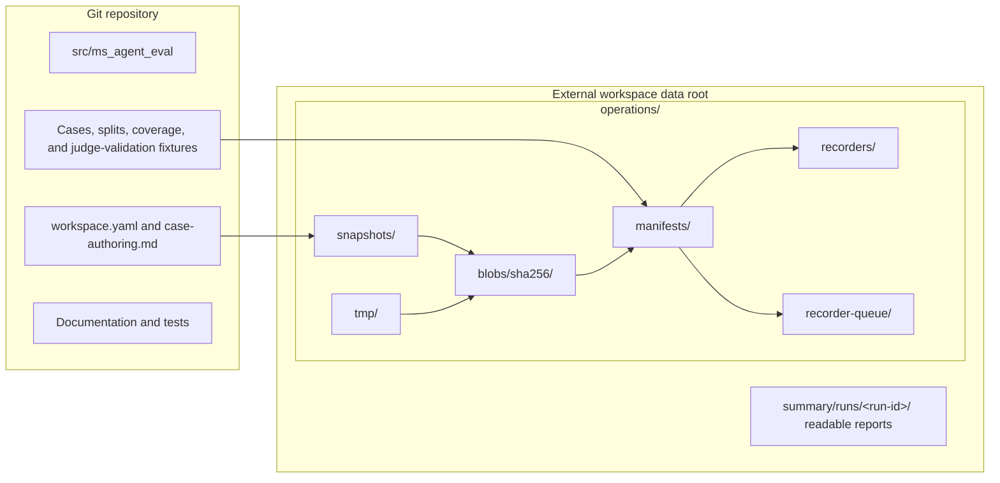

# Architecture Overview

MS Agent Eval separates versioned experiment intent from generated execution
evidence. Target repositories are immutable data sources, not dependencies of
the framework.

## Components and information flow

```mermaid
flowchart TB
    subgraph Git[Versioned inputs]
        Workspace[workspace.yaml]
        Policy[case-authoring.md]
        Cases[Cases, rubrics, coverage, and splits]
        Judge validation[Judge-validation fixtures]
    end

    subgraph Sources[Immutable sources]
        Target[Target repository]
        References[Optional reference repositories]
        Snapshots[Content-addressed snapshots]
        Target --> Snapshots
        References --> Snapshots
    end

    subgraph Coordinator[MS Agent Eval coordinator]
        Lock[Experiment lock]
        Packets[Portable stage packets]
        Views[Stage-specific read-only views]
        Results[Validated stage results]
        Queue[Pointer-only recorder intent]
        Lock --> Packets --> Views --> Results --> Queue
    end

    subgraph Models[Model roles]
        Author[Author]
        Optimizer[Optimizer]
        Solver[Solver]
        Judge[Judge]
    end

    Git --> Lock
    Snapshots --> Lock
    Snapshots --> Author
    Policy --> Author
    Author --> Cases
    Views --> Optimizer
    Views --> Solver
    Views --> Judge
    Solver --> Results
    Judge --> Results
    Queue --> Worker[Managed recorder consumer]
    Results --> Worker
    Worker --> MLflow[MLflow comparison and traces]
```

The author receives locked authoring evidence and writes reviewable experiment
inputs. During a run, the coordinator projects each canonical case into a
solver view or judge view so hidden correctness evidence never reaches the
solver. In COPRO experiments the optimizer receives only the current target,
permitted training-corpus identity, and numeric candidate history; it never
receives judge-only evidence or held-out data.

## Storage ownership



| Versioned in Git | Stored externally |
| --- | --- |
| Framework code and tests | Repository snapshots |
| Workspace configuration | Experiment and run locks |
| Authoring policy | Rendered model requests and responses |
| Capability catalog and grouped splits | Solver and judge results |
| Reviewed cases and rubrics | Compiled DSPy state |
| Reviewed judge-validation candidates | Reports, traces, and temporary attempts |

The default external root is `~/ms_agent_eval/<workspace-id>`. An explicit
`workspace.data_root` may select another location outside the Git workspace.

## Design documents

- [Repository structure](repository-structure.md) describes the source tree and
  experiment workspace in detail.
- [Storage and provenance](storage-and-provenance.md) lists external artifacts
  and the identities required for comparable results.
- [ADR-001](001-portable-staged-execution.md) defines the immutable portable
  stage protocol and resumable lifecycle.
- [ADR-002](002-isolated-codex-cli-execution.md) defines the Codex container,
  information, filesystem, credential, and network boundaries.
- [ADR-003](003-content-addressed-experiment-graph.md) defines immutable
  experiment revisions, stage work identities, incremental invalidation, and
  safe cross-run result reuse.
- [ADR-004](004-pooled-endpoint-concurrency.md) defines capacity-aware pools of
  equivalent OpenAI-compatible endpoints, bounded local concurrency, routing,
  failure handling, and attempt-level endpoint provenance.
- [ADR-005](005-optional-token-preflight.md) defines optional endpoint-native
  chat-template rendering and token preflight, context-aware pooled admission,
  and graceful execution when tokenizer extensions are unavailable.
- [ADR-006](006-experiment-recorder-projection.md) defines recorder-neutral,
  retryable projection of canonical experiment evidence, durable delivery and
  recovery, and the first MLflow adapter.
- [ADR-007](007-configurable-dspy-optimization-strategies.md) defines a
  mutually exclusive workspace choice between labeled few-shot fitting and
  COPRO search, including leakage, budget, identity, artifact, and reporting
  requirements. ADR-012 supersedes its joint prompt-and-skill target contract.
- [ADR-008](008-paired-copro-evaluation-and-formal-reporting.md) defines the
  paired original-versus-optimized COPRO test, exact expected-response token
  measurement, formal summaries, and MLflow chart contract.
- [ADR-009](009-factorial-model-arms-and-deployment-aware-tracking.md) defines
  independently selectable solver, optimizer, and judge experiment arms,
  deployment-aware endpoint routing, comparable benchmark identities, and
  workspace-global MLflow model tracking.
- [ADR-011](011-stateful-optimization-and-semantic-reuse.md) replaces
  independent K-fold searches with one fixed validation holdout and a stateful
  COPRO round chain, and makes stage reuse depend on semantic model inputs
  rather than orchestration coordinates.
- [ADR-012](012-factorized-copro-optimization-scopes.md) separates COPRO into
  mutually exclusive skill or global-instruction search spaces, freezes the
  non-selected instruction layer, and defines factorized identity, artifacts,
  invalidation, validation, and reporting for both experiment types.
- [ADR-013](013-queued-recorder-workers.md) moves all recorder adapters and
  projection phases behind a durable queue, adds worker leases and cursors,
  coalesces live updates, and lets normal runs supervise their recorder
  consumer automatically.
- [DSPy feasibility report](dspy-feasibility-report.md) records the evidence
  behind the DSPy-only program architecture.

Operational instructions belong under [Experiments](../experiments/index.md),
[Training](../training/index.md), [Evaluation](../evaluation/index.md), and
[Execution](../execution/index.md), rather than in architecture decisions.
