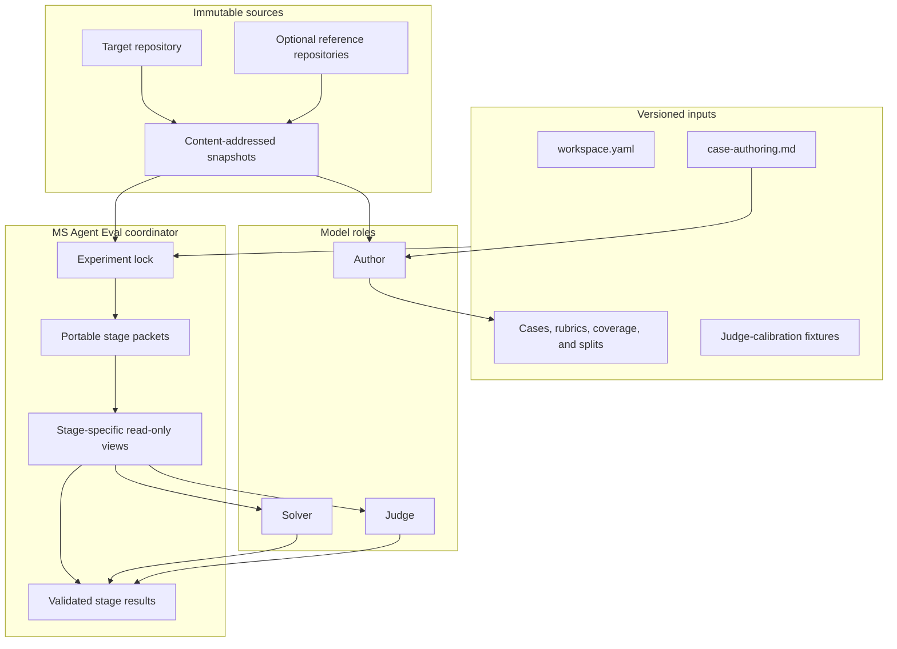
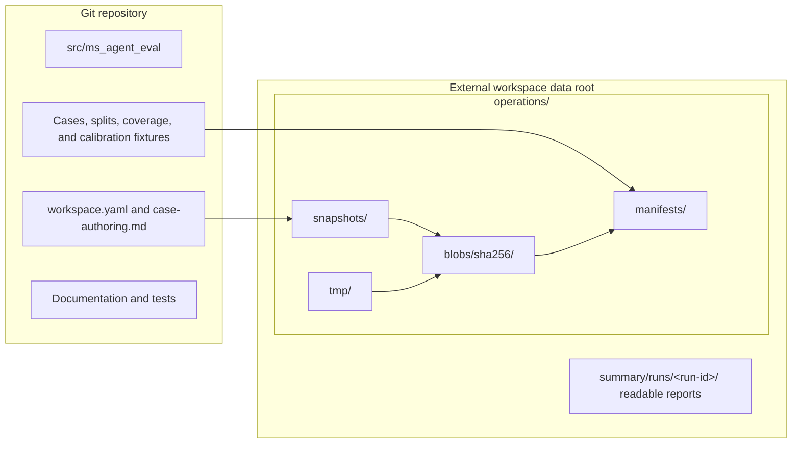

# Architecture Overview

MS Agent Eval separates versioned experiment intent from generated execution
evidence. Target repositories are immutable data sources, not dependencies of
the framework.

## Components and information flow

The author receives locked authoring evidence and writes reviewable experiment
inputs. During a run, the coordinator projects each canonical case into a
solver view or judge view so hidden correctness evidence never reaches the
solver.

## Storage ownership

| Versioned in Git | Stored externally |
| --- | --- |
| Framework code and tests | Repository snapshots |
| Workspace configuration | Experiment and run locks |
| Authoring policy | Rendered model requests and responses |
| Capability catalog and grouped splits | Solver and judge results |
| Promoted cases and rubrics | Compiled DSPy state |
| Reviewed calibration candidates | Reports, traces, and temporary attempts |

The default external root is `~/ms_agent_eval/<workspace-id>`. An explicit
`workspace.data_root` may select another location outside the Git workspace.

## Design documents

- [Repository structure](repository-structure.md) describes the source tree and
  experiment workspace in detail.
- [Storage and provenance](storage-and-provenance.md) lists external artifacts
  and the identities required for comparable results.
- [ADR-001](001-portable-staged-execution.md) defines the immutable portable
  stage protocol and resumable lifecycle.
- [ADR-002](002-isolated-codex-cli-execution.md) defines the Codex container,
  information, filesystem, credential, and network boundaries.
- [ADR-003](003-content-addressed-experiment-graph.md) defines immutable
  experiment revisions, stage work identities, incremental invalidation, and
  safe cross-run result reuse.
- [DSPy feasibility report](dspy-feasibility-report.md) records the evidence
  behind the DSPy-only program architecture.

Operational instructions belong under [Experiments](../experiments/index.md),
[Training](../training/index.md), [Evaluation](../evaluation/index.md), and
[Execution](../execution/index.md), rather than in architecture decisions.
