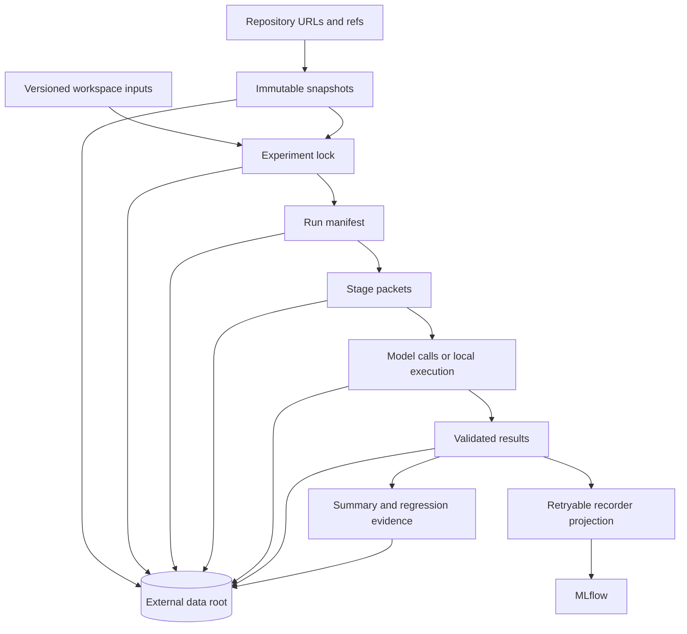

# Storage and Provenance

MS Agent Eval stores reviewable intent in Git and mutable execution evidence in
an external data plane.



## External layout

```text
~/ms_agent_eval/<workspace-id>/
├── operations/                 internal, machine-oriented execution data
│   ├── snapshots/              immutable target and reference repositories
│   ├── blobs/sha256/           requests, responses, state, traces, and evidence
│   ├── manifests/              revisions, work graph, attempts, runs, and results
│   ├── locks/work/             bounded single-flight work lock buckets
│   ├── locks/executors/        per-pool, per-endpoint request slots
│   ├── recorders/              outbox, bindings, receipts, and delivery errors
│   └── tmp/                    atomic staging and disposable attempts
└── summary/
    └── runs/<run-id>/          derived Markdown, CSV, JSON, and case reports
```

Content-addressed blobs are immutable. Manifests reference their content ids and
media types rather than copying mutable paths into the evaluation identity.
The framework creates `summary/runs/<run-id>/` at terminal experiment
finalization. `summary.md`, `results.csv`, `results.json`, and `cases/*.md` are
deterministic projections over retained evidence; reporting never calls an LLM.
These files are derived and can be deleted and rebuilt.

Recorder state is also derived, but its outbox is durable so an unavailable
tracking server can be retried without inference. Pending recorder events are
garbage-collection roots until delivery or supersession has a receipt. MLflow
never replaces the canonical local manifests and blobs.

Within `operations/manifests/`, selected experiment definitions live under
`experiments/<family>/<revision>/`, reusable computations under `graph/work/`,
run-specific packets under `graph/attempts/`, validated outputs under
`graph/results/`, and event history under `runs/<run-id>/`. See
[Incremental execution](../execution/incremental-execution.md) for the exact
identity and eligibility rules.

Each schema-v4 run manifest directly references three immutable revision
records: the experiment lock, the revision bundle, and a schema-v3 experiment
definition stored as a content-addressed blob. The definition, in turn,
references the exact local case, judge-validation, catalog, split, and authoring
files needed to reconstruct the run. Repository content remains in verified
external snapshots and is referenced by snapshot hash. This allows an old run
to resume from its own definition after `workspace.yaml` or the versioned case
bank changes, without copying mutable paths into the run.

## Locked provenance

A comparable result binds at least:

- requested repository ref, resolved commit, snapshot hash, and selected files;
- imported instruction manifest, origin metadata, selected file inventory, and
  exact content hashes;
- authoring source-set, policy, capability-catalog, case-bank, and split hashes;
- solver and judge program/model identities, deployment revisions, and parameters;
- judge-validation set, runtime, executor, budgets, and compiled program; and
- packet dependencies, outputs, model usage, and timestamps; and
- selected endpoint id, pool/replica hashes, configured capacity, queue wait,
  observed concurrency, and latency for endpoint-backed attempts.

Credentials are deliberately excluded from hashes, locks, reports, and error
messages. Configuration records only the environment-variable name or dedicated
authentication-store location.

Generated snapshots, model calls, compiled state, runs, and reports must never
be committed into the experiment workspace.

## Garbage collection

Every model call and DSPy trace is registered under its run, work, and attempt in
`operations/manifests/runs/<run-id>/`. The garbage collector treats manifests as roots and
recursively follows every referenced `content_id`, so retained run evidence is
never selected merely because its blob has an opaque SHA-256 filename.

Garbage collection runs automatically after the terminal `aggregate` packet is
persisted, whether aggregation is reached by a full run, a resumed run, direct
packet execution, or a harness submission. Revision definitions are recursive
reachability roots, so their referenced workspace-file blobs remain live.
There is no routine cleanup command for users to remember.

Terminal finalization always persists evidence first, runs garbage collection
second, and publishes the deterministic report third. A report failure leaves
canonical evidence intact and is retryable without repeating solver or judge
calls.

The collector deletes unreachable blobs and abandoned temporary entries. Files
less than one hour old remain protected so cleanup cannot race another process
that has written a blob but has not yet published its manifest. A later
completed experiment collects those protected abandoned files after the guard
expires.

The collector fails closed when any JSON manifest is invalid. It does not
delete manifests, retained snapshots, or unknown files placed in the blob
directory.

See [Experiment recording](../execution/experiment-recording.md) for the
external projection, privacy policies, and recovery commands.
