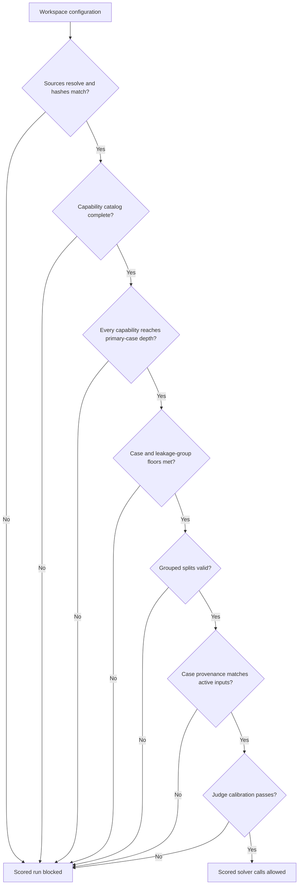
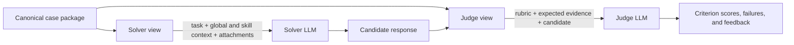

# Evaluation

Evaluation answers a narrow question: how well does one locked solver candidate
perform against one locked correctness contract? A valid result binds the
source revision, cases, split assignments, judge, calibration corpus, solver,
runtime, and model identities.

## Readiness gates

`ms-agent-eval validate` checks the complete contract. `inspect` exposes the
resolved identities, hashes, coverage totals, split assignments, projected
calls, and exact blockers without making solver calls.

## Three run types

| Run | Cases available | Optimization | Output status |
| --- | --- | --- | --- |
| Diagnostic pilot | Train and validation only | Prohibited | `benchmark_valid: false`; per-case diagnostics; no aggregate benchmark metrics. |
| Baseline benchmark | The evaluation experiment's configured cases | None | Comparable only with the same locked evaluation identity. |
| Optimization benchmark | Train for compilation, validation before final evaluation, test after candidate publication | DSPy `LabeledFewShot` | Held-out test metrics for the published compiled candidate. |

A pilot helps exercise calibration, solver, and judge wiring while authoring is
incomplete. It is not a weaker validation mode and must never be presented as a
benchmark.

## What the solver and judge can see

The canonical case package is projected into separate immutable views:

The solver never receives the rubric or expected result. The judge receives the
candidate and correctness evidence but not private pass thresholds. Calibration
invocations receive one candidate fixture without its label or accepted range.

## Evaluation outputs

The append-only external data plane records:

- the immutable experiment lock and run manifest;
- stage packets, attempts, transitions, and validated results;
- per-case criterion scores, hard failures, feedback, and final score;
- solver and judge call counts, token usage, latency, and configured cost;
- benchmark mean score and pass rate for valid benchmark runs; and
- hashes for every source, case, program, model, calibration corpus, and
  compiled artifact involved.

Read the [capability coverage contract](capability-coverage.md) to build the
case bank and [judging and calibration](judging-and-calibration.md) for the
semantic scoring boundary. Training-specific split rules are documented under
[Training and optimization](../training/index.md). See
[Pilot versus scored runs](pilot-vs-scored-runs.md) and
[Interpreting results](interpreting-results.md) for operational guidance.
