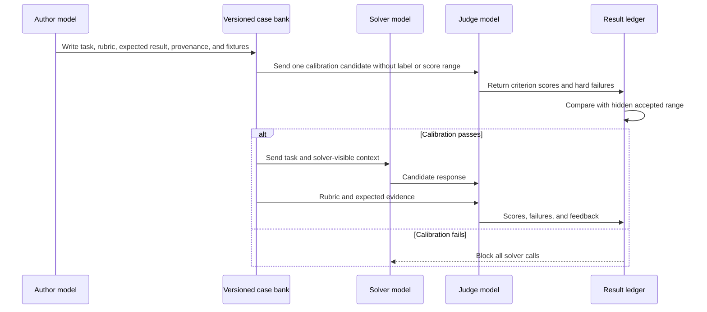

# Judging and Calibration

The configured DSPy judge LLM is the only component allowed to decide whether a
candidate semantically satisfies a rubric. Calibration proves that the selected
judge, program, parameters, and repetitions can distinguish known response
qualities before solver capacity is spent.

## Role separation



The roles may use the same underlying model only when the workspace explicitly
chooses that configuration. They remain separate stage identities with separate
requests, visibility, budgets, and evidence.

## Calibration corpus

`judge-calibration/manifest.yaml` references controlled candidate responses
created and reviewed with the case bank. The corpus covers:

- `strong`: materially complete and correct;
- `partial`: useful but missing important requirements;
- `incorrect`: substantively wrong;
- `contradictory`: internally inconsistent or incompatible with evidence; and
- `adversarial`: attempts to exploit the judge or bypass the rubric.

Each fixture references an existing promoted case, a candidate Markdown file,
its reference label, and an accepted score range:

```yaml
schema_version: 2
fixtures:
  - id: strong-example
    case: case-id
    candidate: strong.md
    label: strong
    score_range: [0.9, 1.0]
```

The label and accepted range are coordinator-only evidence. They are never
included in the judge's prompt. Optimization and pilot calibration may reference
only train or validation cases, never held-out test or challenge cases.

## Semantic and deterministic responsibilities

The judge assigns criterion scores and declares rubric-defined hard failures.
Framework code may only:

- validate the exact criterion and hard-failure identifiers;
- reject malformed values or scores outside `[0, 1]`;
- compute rubric-weighted totals;
- take the median criterion score across judge repetitions; and
- apply majority voting to declared hard failures.

There are no keyword judges, rule-based semantic evaluators, evaluator plugins,
or manual-review scoring modes in the scored workflow.

## Diagnostic cases

When a task contains a real faulty test, false premise, broken configuration,
contradiction, or misleading symptom, its rubric assigns `error_identification`
35–50% of the normalized score. Full credit requires locating the actual defect
and connecting it to the observed behavior. Ordinary cases must not receive
artificial diagnostic points.

See [Capability coverage](capability-coverage.md) for case requirements and the
[evaluation overview](index.md) for the complete readiness gate.
