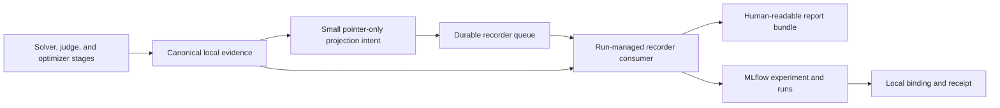

# Experiment Recording with MLflow

MS Agent Eval records runs through a recorder-neutral durable queue while
retaining the external filesystem artifact store as the source of truth.
MLflow is the first adapter. A normal `run` command automatically manages one
run-scoped recorder consumer in the background; recorder failures cannot alter
scores, stage results, or reuse.

## Data flow



Every stage result is committed locally before a projection intent is queued.
The semantic coordinator never imports MLflow, builds tables, renders charts,
or constructs a recording plan. The public runner supervises a recorder
consumer around coordinator execution. Live intents coalesce by run and
recorder; stage and finalization intents remain durable. Historical projection
reads canonical evidence and makes zero author, solver, judge, or optimizer
calls. See
[ADR-013](../architecture/013-queued-recorder-workers.md).

## Install and run MLflow

Install the pinned optional client and server dependency:

```bash
uv sync --python 3.12 --extra mlflow
```

Keep the MLflow database and artifact directory outside Git. For example,
replace both absolute paths below with a location under your external data
storage:

```bash
uv run --extra mlflow mlflow server \
  --backend-store-uri sqlite:////absolute/path/outside/git/mlflow.db \
  --artifacts-destination /absolute/path/outside/git/mlflow-artifacts \
  --host 127.0.0.1 \
  --port 5000
```

The example workspaces expect `http://127.0.0.1:5000`. A shared deployment may
use any HTTP(S) tracking URL allowed by `recorders.<id>.tracking_uri`.

## Configure a workspace

Recorder settings are durable workspace configuration, not environment
variables:

```yaml
schema_version: 17

recording:
  enabled: true
  recorder: local-mlflow
  queue: local-recorder-queue
  failure_policy: continue
  wait_on_run_exit: false
  artifact_policy: full
  content_policy: full
  projection:
    live: {enabled: true, minimum_interval_seconds: 15}
    stage_boundary: {tables: incremental, summaries: true}
    finalization: {reports: true, plotly: true, evidence: true}
    traces:
      optimization: {policy: winners_failures_and_sample, sample_rate: 0.05}
      validation: {policy: full}
      test: {policy: full}

recorders:
  local-mlflow:
    type: mlflow
    tracking_uri: http://127.0.0.1:5000
    experiment_name: ms-agent-eval/{workspace_id}
    authentication:
      type: none

recorder_queues:
  local-recorder-queue:
    type: filesystem
    path: operations/recorder-queue
    live_coalescing: true
    lease_seconds: 300
    max_attempts: 12
```

`projection` controls what the managed consumer produces. `recorder_queues`
controls durable delivery and retry. The consumer always drains immediately
eligible work before the `run` command exits. With `wait_on_run_exit: false`,
it does not wait through retry backoff when the recorder is unavailable; with
`true`, it waits for delivery or terminal dead-letter state. The only supported
failure policy is `continue`: failed delivery is visible and retryable but
cannot change the experiment result.

Live checkpoints record progress metrics, compact traces, and current graph
artifacts. Complete result tables are terminal assets: uploading a new
full-table snapshot after every case would create unbounded duplicate MLflow
artifacts and overload the tracking service. Failed and cancelled runs also
receive terminal tables for the evidence that exists.

`artifact_policy` controls how much of the canonical artifact graph is
uploaded:

- `index_only` uploads the artifact index and recorder manifest.
- `full` also uploads reports, tables, graphs, identity documents, and evidence
  allowed by `content_policy`.

`content_policy` controls content exposure:

- `hashes_only` records identities and scalar metadata.
- `summary` records reports and non-sensitive aggregate material.
- `full` records configured prompts, responses, expected evidence, and trace
  provenance. Complete bodies live in immutable MLflow artifacts; trace
  input/output fields contain bounded content-id and artifact-path pointers so
  tracking-server attribute limits cannot truncate JSON.

Use `full` only when the tracking server is approved for the experiment's
private content. A secret-like value detected in a full-content projection
fails that recorder delivery and is never silently uploaded.

Basic and bearer authentication store only credential names in YAML:

```yaml
authentication:
  type: basic
  username_env: MLFLOW_TRACKING_USERNAME
  password_env: MLFLOW_TRACKING_PASSWORD
```

or:

```yaml
authentication:
  type: bearer
  token_env: MLFLOW_TRACKING_TOKEN
```

Secret values remain process-local and are redacted from recorder errors.

## Validate before a run

The default doctor performs a temporary write/read probe covering an artifact,
table, and trace, then deletes the probe run:

```bash
uv run --extra mlflow ms-agent-eval recorder doctor \
  --workspace experiments/mainsequence-sdk/workspace.yaml
```

Use `--read-only` for a connectivity and visibility check that creates no
probe:

```bash
uv run --extra mlflow ms-agent-eval recorder doctor --read-only \
  --workspace experiments/mainsequence-sdk/workspace.yaml
```

## Run and inspect

One command executes the experiment and manages recording:

```bash
uv run --extra mlflow ms-agent-eval run baseline \
  --workspace experiments/mainsequence-sdk/workspace.yaml
```

No separate recorder command is required. For recovery, backfill, or a
separately deployed shared-storage consumer, the optional worker command is:

```bash
uv run --extra mlflow ms-agent-eval recorder worker \
  --workspace experiments/mainsequence-sdk/workspace.yaml
```

For a bounded job that projects one run and exits:

```bash
uv run --extra mlflow ms-agent-eval recorder project \
  --workspace experiments/mainsequence-sdk/workspace.yaml \
  --run <run-id>
```

`recorder worker --once` drains currently available work and exits. Queue
status is separate from experiment status:

```bash
uv run ms-agent-eval recorder status \
  --workspace experiments/mainsequence-sdk/workspace.yaml \
  --run <run-id>
```

Open the parent run's **Artifacts** tab and select `index.html`. That is the
human entry point for the run: it links to the interactive Plotly report and
the sortable table explorer. MLflow's **Model metrics** tab shows scalar metric
series; it does not embed arbitrary Plotly HTML artifacts.

The same human assets are always materialized locally at
`<data-root>/summary/runs/<run-id>/index.html`. Its `graphs/` directory contains
the Plotly HTML, SVG fallbacks, chart manifest, and execution DAG; its
`tables/index.html` is the sortable table browser. These local views are not
duplicated under MLflow's `reports/` prefix. Operational views are available
for failed and cancelled terminal runs even when no aggregate report exists.

All arms for one workspace are recorded in one MLflow Experiment. One MLflow
parent run represents each canonical local arm execution. Nested MLflow runs
represent stable stage scopes such as judge validation, solve, judge,
aggregation, optimization candidates, validation, and search rounds. The projection includes:

- scalar score, usage, latency, failure, and reuse metrics;
- stage-attempt, model-call, case-result, criterion, endpoint, calibration, and
  optimization tables;
- a trace per stage attempt with provider-call spans;
- dependency and reuse lineage in trace attributes and execution-DAG artifacts;
- interactive Plotly HTML plus described SVG exports for score, criterion,
  latency, token, endpoint, reuse, and optimization charts when their inputs
  exist;
- a bounded execution-scope DAG with rendered dependency/retry arrows, a
  machine-readable chart manifest, and an interactive latency/token explorer;
- frozen identity documents, report bundles, artifact indexes, and configured
  evidence.

`tables/index.html` renders every available terminal table with search, column
sorting, and pagination. The hashed `.json` files beside it are MLflow's
canonical `log_table` representation and remain machine-readable inputs. The
recorder must log each table exactly once: uploading a second generic JSON file
to the same path would overwrite MLflow's table schema and prevent the UI from
recognizing it.

Failures are not represented by a bare `failed` state. Three tables lead the
browser whenever failure evidence exists:

- `failure-summary` groups failures by stage, normalized error kind, and
  endpoint, with affected scopes/cases, counts, example messages, retryability,
  and recovery status;
- `stage-failures` records the affected case and skill, stage and scope, stage
  error, deepest provider exception, HTTP status/error code/errno when
  available, endpoint ids and URLs, attempt timing, and whether a later attempt
  recovered the same work; and
- `model-call-failures` records every individual failed provider call with its
  model, provider, endpoint, redacted exception chain, retryability, latency,
  and correlation ids.

New calls persist these diagnostics structurally. Reports can still recover the
message and endpoint from older call response artifacts, although fields that
were never recorded by an older run remain empty rather than being invented.

Objects retain `agent_eval.*` tags containing the local run, revision, work,
attempt, result, executor, model, and recorder identities. Empty charts are
omitted and listed with a reason in the recording plan.

Every valid completed arm also creates an immutable derived run with
`agent_eval.run_kind=model_comparison`. It selects the latest completed report
for each `arm_id` only when `benchmark_revision_id`, `comparison_group_id`, and
the named `comparison_id` all match. Its `comparison/comparison-manifest.json`
pins the exact input run ids and report hashes; later arms create a new manifest
and comparison run rather than rewriting prior evidence.

The comparison run records these MLflow tables:

- `model-arm-comparison`: solver, optimizer, judge, revisions, absolute score,
  paired baseline, optimizer delta, latency, tokens, requests, and sample count;
- `model-skill-comparison`: arm score and paired lift by skill; and
- `model-token-band-comparison`: score by concrete expected-response token band.

With `artifact_policy: full`, `comparison/graphs/` contains interactive Plotly
HTML plus static SVG for baseline solver score, optimized solver/program score,
paired optimizer lift ordered by delta, model-by-skill score, token-band score,
quality versus latency, and quality versus tokens. Absolute optimized score is
attributed to the solver/program pair; optimizer effectiveness is the paired
delta. No chart combines different cases, split policies, judge identities, or
benchmark revisions.

The derived comparison run also has its own root `index.html` and
`tables/index.html`, so cross-model charts and tables use the same human entry
points as an individual experiment arm.

Open `graphs/index.html` in the MLflow artifact tree for the complete chart
dashboard and model-call explorer. It renders every available analytical chart
inline, presents unavailable charts as explicit missing-evidence panels, filters
calls by stage, endpoint, status, and cache state, and plots latency against
tokens. The individual charts support hover, zoom, selection, legend filtering,
and SVG export without embedding prompts or responses. Every analytical chart
is also recorded twice under the same basename:

- `.html` is the canonical interactive Plotly view rendered by MLflow's HTML
  artifact preview; and
- `.svg` is the deterministic static export for reports, accessibility, and
  non-HTML consumers.

The chart manifest treats the `.html` path as the canonical human artifact and
the `.svg` path as `static_artifact`. A failed or unfinished optimization run
cannot contain final original-versus-optimized charts because no paired
untouched-test aggregate exists yet. Those entries remain visible in
`graphs/manifest.json` with
`optimization_incomplete_before_test_comparison`; they are generated
automatically once the run reaches successful aggregation.

The execution graph is the deliberate exception: `execution-dag.svg` is a
true node-and-edge graph backed by `execution-dag.json`, not a Plotly category
chart. The portable static summaries include:

- `execution-dag.svg`: collapsed execution scopes and actual dependency/retry
  edges. Green nodes mean every attempt in that scope persisted; orange means
  at least one attempt is unfinished; red means at least one attempt failed or
  was rejected. Solid gray arrows are dependencies and dashed purple arrows
  are retries. Each node prints its state counts, attempt count, and cache reuse
  count. The complete work/attempt/result graph remains in `execution-dag.json`;
- `stage-latency-summary.svg`: p50, p95, and maximum duration for newly
  executed stage attempts;
- `token-usage-by-stage.svg`: input, output, and unclassified provider tokens;
- `endpoint-workload.svg`: request counts, not utilization;
- `endpoint-saturation.svg`: peak observed concurrency divided by configured
  capacity, not average utilization; and
- `cache-reuse-by-stage.svg`: executed versus exactly reused results within
  each stage.

`graphs/manifest.json` is authoritative for each chart's interactive and static
artifact paths, question, description, source table, unit, generation status,
and omission reason. Every SVG repeats its definition in a visible subtitle
and accessible `<title>` and `<desc>` elements. Plotly HTML uses the versioned
Plotly CDN, matching MLflow's own `log_figure` behavior; if a viewer cannot
reach that CDN, the adjacent SVG remains usable.

MLflow model metrics also receive terminal stage-level latency percentiles,
input/output/unclassified token totals, per-endpoint request/failure/queue/peak
saturation measurements, and per-stage cache counts and ratios. These metrics
support native run comparison while `graphs/index.html` retains call-level
filtering and inspection.

COPRO runs add paired original-versus-optimized metrics, tables, and six formal
interactive Plotly charts with SVG exports. The skill chart is ordered by
signed optimization delta. Token-based charts use exact hidden expected-response
counts without chat templates or special tokens. The complete asset list and
metric definitions are in
[Formal COPRO summary](../evaluation/formal-copro-summary.md).

## Status, recovery, and backfill

Inspect one run's durable delivery state:

```bash
uv run --extra mlflow ms-agent-eval recorder status \
  --run <run-id> \
  --workspace experiments/mainsequence-sdk/workspace.yaml
```

Project or backfill one run without inference:

```bash
uv run --extra mlflow ms-agent-eval recorder project \
  --run <run-id> \
  --workspace experiments/mainsequence-sdk/workspace.yaml
```

Projection is idempotent. Bindings preserve external experiment, run, scope,
and trace identifiers; content-derived item ids prevent duplicate metrics,
tables, artifacts, and traces. The worker cursor prevents reprocessing an
acknowledged evidence range, and expired leases return to the queue.
If the bound MLflow experiment was soft-deleted, the adapter restores that
exact experiment before touching its bound runs. The durable binding therefore
does not become a permanently failing pointer to a deleted container.

Operational delivery state lives at:

```text
<data-root>/operations/
├── recorder-queue/<queue-id>/
│   ├── pending/
│   ├── leased/
│   ├── acknowledged/
│   ├── dead-letter/
│   └── state/<recorder-config-hash>/<run-id>/cursor.json
└── recorders/<recorder-id>/<recorder-config-hash>/runs/<run-id>/
    └── binding.json
```

Pending, leased, and dead-letter required intents remain garbage-collection
roots. Acknowledged live intents may be compacted after the cursor and receipt
are durable; canonical run evidence remains governed by its manifests.

Changing a tracking URL, experiment-name template, authentication reference,
or recording policy creates a different `recorder_config_hash`. It does not
change the experiment revision or any model work id, so the same completed run
can be projected to a new destination without spending inference tokens.

See [ADR-006](../architecture/006-experiment-recorder-projection.md) for the
identity, privacy, and adapter mappings, and
[ADR-013](../architecture/013-queued-recorder-workers.md) for queue and worker
execution semantics.
