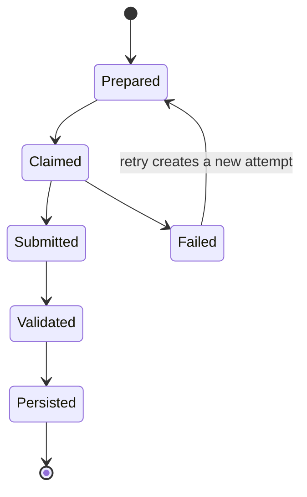

# Execution

Every stage uses the same immutable packet/result lifecycle. An executor decides
where the stage runs; it does not change what the packet means or which evidence
must be recorded.

## Portable stage lifecycle



Packets bind the run, stage, dependencies, executor, model, instructions,
inputs, output schema, and budget. Packet schema v2 separates a stable
`work_id` from its run-specific `attempt_id`. Results bind both identities, worker,
observed model, output artifacts, usage, timestamps, and failure evidence.

## Executor choices

| Executor | Use it for | Model authentication | Isolation |
| --- | --- | --- | --- |
| OpenAI-compatible endpoint pool | Optimizer, solver, judge, or other model-driven DSPy stages served over one or more HTTP replicas | Optional per-endpoint key named by `api_key_env` | Remote service boundary plus explicit per-replica capacity |
| Codex CLI harness | Subscription-backed model stages in disposable containers | Dedicated ChatGPT subscription store | Digest-pinned container plus restricted control-plane network |
| Artifact-exchange harness | A human or external agent that claims packets and submits structured results | Owned by the external worker | Defined by the external worker |
| Local process | Deterministic coordination such as validation assignment, candidate selection, final materialization, and aggregation | None | Framework process |

The executor, model, and stage binding are separate configuration objects. This
allows roles to share an endpoint while keeping distinct model identities,
parameters, budgets, and evidence.

## Automatic and external operation

Run the complete coordinator:

```bash
uv run ms-agent-eval run baseline --workspace workspace.yaml
```

When recording is enabled, this same command starts and stops the run-scoped
recorder consumer automatically. The standalone recorder-worker command is
only for recovery or deliberately distributed operation.

Calculate token fit and usable endpoint concurrency first, without generation
or run artifacts:

```bash
uv run ms-agent-eval preflight baseline --workspace workspace.yaml
```

This is a workload preflight, not merely a case counter. It prints the expanded
case sets, stage formulas, fresh model-call upper bound, local operations,
stateful COPRO search, models, deployments, endpoints, and usable
concurrency before showing token-fit diagnostics. It performs no generation and
does not create a run. The interactive `run` header repeats a compact workload
summary before any model request.

Pause after a stage and inspect the ledger:

```bash
uv run ms-agent-eval run baseline --through solve --workspace workspace.yaml
uv run ms-agent-eval stage list --run <run-id> --workspace workspace.yaml
uv run ms-agent-eval run resume <run-id> --workspace workspace.yaml
```

External workers use `stage prepare`, `stage claim`, and `stage submit`. A retry
never mutates the failed attempt; it creates a new immutable attempt attached to
the same logical stage.

Choose [OpenAI-compatible API](openai-compatible-api.md) for HTTP model servers
or [Codex CLI](codex-cli.md) for the subscription-backed isolated harness. The
recovery workflow is documented in [Resume and recovery](resume-and-recovery.md).
Configure automatic run comparison, traces, graphs, artifacts, and historical
backfill in [Experiment recording with MLflow](experiment-recording.md).
The security and protocol rationale lives in
[ADR-001](../architecture/001-portable-staged-execution.md) and
[ADR-002](../architecture/002-isolated-codex-cli-execution.md).

For cross-run cache eligibility, invalidation, model deployment revisions,
replication, storage, and report accounting, read
[Incremental execution and reuse](incremental-execution.md).
Capacity-aware replica scheduling is specified by
[ADR-004](../architecture/004-pooled-endpoint-concurrency.md).
Optional endpoint-native context admission and its graceful skip behavior are
specified by [ADR-005](../architecture/005-optional-token-preflight.md).
The mutually exclusive labeled-few-shot and COPRO strategies are introduced by
[ADR-007](../architecture/007-configurable-dspy-optimization-strategies.md);
[ADR-011](../architecture/011-stateful-optimization-and-semantic-reuse.md)
defines their current fixed-validation and semantic-reuse execution graph.
