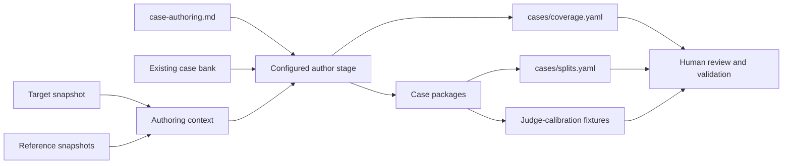

# Case Authoring

Case authoring converts locked repository evidence into a versioned capability
catalog, promoted case packages, grouped splits, and judge-calibration fixtures.
Those outputs define the evaluation; they are not disposable model traces.

## Authoring flow



The author reads the complete selected skills and required supporting files. It
uses optional tutorials or project repositories only as reference-labelled
evidence; target instructions remain normative when sources disagree.

## Required outputs

One campaign owns all four connected records:

1. A complete capability decomposition for every selected skill.
2. Materially distinct cases until each capability reaches its configured
   primary-case depth and each skill reaches case/group floors.
3. Leakage-group assignments and deterministic train/validation/test/challenge
   splits.
4. Controlled strong, partial, incorrect, contradictory, and adversarial
   responses for judge calibration.

A requested case count is a lower bound, not permission to stop with incomplete
semantic coverage.

## Canonical case package

```text
cases/<skill>/<case>/
├── case.yaml
├── solver/
│   ├── prompt.md
│   └── attachments/            optional solver-visible files
└── judge/
    ├── rubric.yaml
    └── expected/
        ├── response.md
        └── artifacts/          optional judge-only evidence
```

`case.yaml` identifies the skill, leakage group, primary and supporting
capabilities, archetype, difficulty, source evidence, and authoring provenance.
Changing the policy, capability catalog, source set, or package bytes requires
review and refreshed provenance before the case can run.

See [Capability coverage](../evaluation/capability-coverage.md) for catalog and
depth rules and [Judging and calibration](../evaluation/judging-and-calibration.md)
for fixture and rubric requirements.
