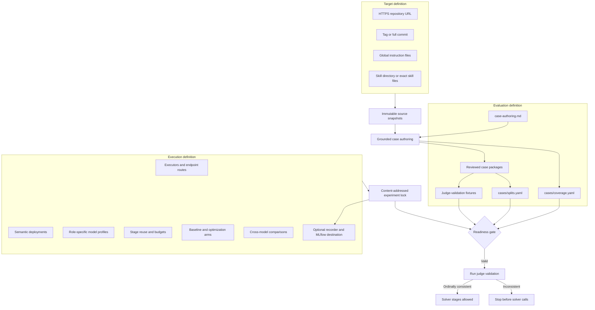

# Experiment Setup and Requirements

An experiment is a versioned definition of what repository behavior is being
tested and how model-driven stages should run. The small Git workspace contains
reviewable inputs; immutable source snapshots and every generated artifact live
under the external data root.

## Required setup



The framework will not begin a scored run until each required identity and
integrity check can be locked.

| Requirement | Where it is declared | What must be true |
| --- | --- | --- |
| Target source | `evaluation.repository` | URL/ref resolves to one immutable commit and snapshot. |
| Instructions | `evaluation.instructions` | Global files exist; exactly one of `skills.directory` or `skills.files` is selected. |
| Authoring policy | `evaluation.case_authoring.instructions` | The versioned file exists and its exact bytes are included in provenance. |
| Capability catalog | `evaluation.cases.coverage.catalog` | Status is complete and every selected skill/capability is represented. |
| Case bank | `evaluation.cases.directory` | Packages validate, retain provenance, and meet capability depth and diversity floors. |
| Splits | `evaluation.splits` | Whole leakage groups map deterministically to train, test, or challenge. |
| Judge validation | `evaluation.judge.validation` | Controlled training-case fixtures cover every required label and the judge preserves their ordinal quality ordering. |
| Execution | `executors`, `deployments`, `models`, and `stages` | Every profile resolves to an eligible deployment route and every stage has finite reuse and budget policy. |
| Run definition | `experiments` | The selected arm binds solver and judge profiles, plus an optimizer profile for COPRO. |
| Comparison | `comparisons` | Named baseline and optimization arms share one compatible benchmark and fixed-judge comparison group. |
| Recording | `recording` and `recorders` | Optional projection destination and privacy policies validate independently from experiment identity. |

## Versioned workspace layout

```text
<experiment>/
├── workspace.yaml
├── case-authoring.md
├── .env.example                 optional credential-name template
├── cases/
│   ├── README.md
│   ├── coverage.yaml
│   ├── splits.yaml
│   └── <skill>/<case>/
│       ├── case.yaml
│       ├── solver/
│       └── judge/
└── judge-validation/
    ├── manifest.yaml
    └── *.md
```

Repository snapshots, locks, requests, responses, optimizer state, results,
and reports do not belong in this directory. See the
[architecture overview](../architecture/index.md) for the storage boundary.

## From empty workspace to benchmark

1. Run `ms-agent-eval setup` interactively or `ms-agent-eval init` for an
   explicit configuration.
2. Resolve the target and optional reference sources to immutable snapshots.
3. Ask the configured author stage to build the capability catalog, case bank,
   grouped splits, and judge-validation set.
4. Run `validate` and `inspect`. Address every reported blocker.
5. If recording is enabled, run `recorder doctor` against the configured
   destination.
6. Use a pilot while the corpus is incomplete; treat its output only as
   diagnostics.
7. Run the baseline benchmark, an optimization experiment, or both after the
   scored-run readiness gate passes.
8. Compare only results whose locked evaluation identities are compatible.

Use the [getting-started guide](getting-started.md) for commands and a complete
configuration example. Use [target sources](target-sources.md) for snapshot and
reference-repository rules. The focused guides cover
[workspace configuration](workspace-configuration.md),
[model arms and cross-model comparisons](model-comparisons.md),
[case authoring](case-authoring.md), and
[running an experiment](running-an-experiment.md).
