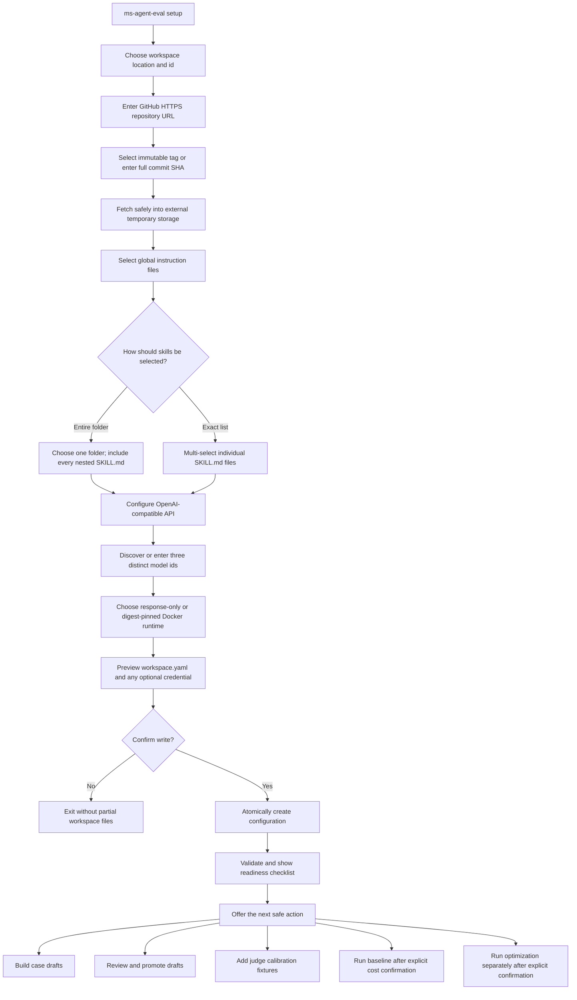

# 018 — Guided CLI and OpenAI-Compatible API Configuration

Status: Complete (2026-09-05)
Priority: P0 / first-run UX and provider correctness

## Outcome

A new user can run one guided command and configure an evaluation workspace
without first learning the YAML schema, repository layout, or skill-selection
rules.

The model connection is defined as an OpenAI-compatible HTTP API, not as
Ollama. Ollama may still be used through its OpenAI-compatible `/v1` endpoint,
but it is only one possible server. The active configuration contains no
`OLLAMA_*` variables and no `MS_AGENT_EVAL_*` variables.

The guided CLI is an orchestration layer over the same validation, snapshot,
case-building, judging, and running services used by non-interactive commands.
It must not create a second execution path.

## Problems to correct

The current UX has four coupled problems:

1. `init` requires users to know repository paths before the CLI has inspected
   the selected repository.
2. Skill selection is expressed as flags, so users cannot browse the available
   skill directories or choose `SKILL.md` files interactively.
3. The configuration schema and provider package hardcode `ollama`, although
   DSPy can talk to an OpenAI-compatible API at a configured base URL.
4. Model identities and API locations are incorrectly treated as process
   environment instead of durable workspace configuration.

There is also no API-key configuration, no model discovery, no atomic review
screen, and no state-aware path from an empty workspace to a runnable
experiment.

## Canonical commands

```text
ms-agent-eval setup [--workspace PATH]
```

`setup` is the primary human workflow. It creates a workspace when the file is
absent and resumes/configures it when the file exists. Running
`ms-agent-eval` with no arguments in an interactive terminal should offer to
start `setup`.

The existing atomic commands remain the automation API:

```text
ms-agent-eval init ...
ms-agent-eval validate ...
ms-agent-eval inspect ...
ms-agent-eval cases build ...
ms-agent-eval cases inspect-drafts ...
ms-agent-eval cases promote ...
ms-agent-eval run ...
```

`init` remains non-interactive for scripts and CI. `setup` calls shared Python
services directly; it must not shell out to `ms-agent-eval` recursively.

## Guided flow



## Step-by-step UX contract

### 1. Workspace

Prompt for:

- workspace directory;
- lowercase workspace id, derived from the directory name by default;
- external data root, defaulting to `~/ms_agent_eval/<workspace-id>`;
- whether an existing workspace should be opened for continuation.

The external data root must still be outside the Git workspace. The wizard
must display both absolute paths before it performs a fetch or write.

### 2. Repository and immutable revision

Prompt for one HTTPS GitHub repository URL because that is the source provider
currently implemented. Do not claim support for arbitrary Git hosts until the
source layer supports them.

After validating the URL, allow the user to:

- choose a tag returned by safe `git ls-remote` discovery; or
- paste a full lowercase 40-character commit SHA.

Branches are not accepted because they are mutable. Resolve a tag to its full
commit before showing the review screen. No repository hook, import, build, or
project command may execute during discovery.

### 3. Instructions and skills

Inspect the temporary immutable checkout and show repository-relative paths.

Global instructions use a multi-select list of plausible instruction files,
including discovered `AGENTS.md` files, with a manual-path option. Every
selected path must be a regular file inside the snapshot.

Skill selection has exactly two choices:

1. **Entire folder** — select one directory. Every nested file named
   `SKILL.md` is included recursively.
2. **Exact list** — multi-select one or more individual files whose basename is
   exactly `SKILL.md`.

There is no expected-count assertion. The review screen shows the final count,
ids, and paths. Empty discovery, duplicate derived ids, symlinks, traversal,
and selecting both modes remain hard errors.

### 4. Cases

Prompt for the versioned case directory, default `cases`. If it already
contains cases, show their count and validate them before continuing. Otherwise
create only the empty directory, `splits.yaml`, and judge-calibration skeleton
after final confirmation.

The wizard should ask for an initial case-coverage request, but it must not call
the case-builder LLM until the user explicitly chooses **Build drafts now** and
accepts the displayed model-call budget.

### 5. OpenAI-compatible API

The API address and model id are stored directly in each role's versioned
configuration:

```yaml
model:
  provider: openai_compatible
  name: builder-model
  base_url: http://127.0.0.1:11434/v1
  # Only when authentication is required:
  api_key_env: OPENAI_API_KEY
```

Rules:

- `base_url` is the versioned address of an OpenAI-compatible API. It is not
  named after Ollama.
- `name` is the versioned model id for that role.
- Builder, solver, and judge must configure three distinct model ids.
- `api_key_env` is omitted for unauthenticated local servers. When present, it
  references only a secret credential.
- No project-specific environment namespace is generated.

The wizard prompts for the base URL, validates HTTP(S) syntax, and offers an
explicit **Test connection and list models** action. Model discovery calls the
compatible `/models` endpoint and does not perform an inference. If that route
is unsupported, the user can enter model ids manually.

API keys are entered with hidden input. With permission, the wizard writes the
real value only to ignored `.env` with mode `0600`. Authenticated workspaces
may include a blank `.env.example`; unauthenticated workspaces create neither
file. A key must never appear in terminal summaries, exception messages,
hashes, manifests, model-call evidence, or generated reports.

An advanced path may configure different base URLs or key-variable names per
role, but it must not complicate the default shared-connection flow.

### 6. Models and experiments

Show discovered model ids once and ask the user to choose:

- case builder;
- solver;
- judge.

Reject a duplicate immediately rather than waiting for run preflight. Then
configure:

- baseline repetitions;
- judge repetitions and budgets;
- response-only or Docker runtime;
- Python version, with 3.12 as the default and 3.12+ required;
- a digest-pinned image and network policy when Docker is selected;
- whether to scaffold the separate `LabeledFewShot` optimization experiment.

The wizard does not merge baseline evaluation and optimization. Optimization
continues to use train/development data, publish state-only DSPy JSON, and only
then evaluate the untouched test set.

### 7. Review, atomic write, and continuation

Before writing, display:

- requested repository URL and resolved commit;
- global instruction files;
- selected skill mode, count, ids, and paths;
- model endpoint and three role identities, with credentials redacted;
- workspace path and external data root;
- runtime and estimated maximum model calls;
- every file that will be created or changed.

Require confirmation. New workspace files are written with atomic replacement;
the writer preflights every destination and rolls back every file and directory
it created if a later write fails. Cancellation, `Ctrl-C`, validation failure,
or a model-discovery error must not leave a partial versioned workspace.
Temporary source discovery data is removed on abort.

After creation, show a state-aware checklist:

```text
[ready] source snapshot
[ready] global instructions
[ready] selected skills (20)
[missing] promoted cases
[missing] judge calibration
[blocked] baseline run
[blocked] optimization run
```

The user may continue interactively or exit and rerun `setup` later. Every
cost-bearing or version-controlled mutation requires its own confirmation.

## Workspace schema clean break

Bump the workspace schema version because the provider contract changes. Replace
the legacy Ollama model-name and endpoint environment indirection with direct,
durable configuration:

```yaml
provider: openai_compatible
name: solver-model
base_url: https://provider.example/v1
api_key_env: OPENAI_API_KEY
parameters:
  temperature: 0.2
```

`api_key_env` is optional and is the only environment indirection in a model
configuration. The schema rejects `provider: ollama`, model-name environment
fields, and endpoint environment fields; there are no compatibility aliases or
deprecated shims.

Resolved model identity includes the normalized API base URL, provider id,
model id, and generation parameters. It excludes the API-key value. Distinct
role validation remains based on provider plus model id, so changing endpoints
does not make reuse of one model across roles acceptable.

## Provider refactor

Remove `src/ms_agent_eval/providers/ollama/` and replace it with
`src/ms_agent_eval/providers/openai_compatible/`.

The provider must:

- validate a credential-free HTTP(S) base URL without silently appending a
  path;
- bind DSPy through the OpenAI-compatible/LiteLLM model route rather than
  `ollama_chat/...`;
- pass the API key only at request time;
- preserve the existing observed-call, budget, retry, cache, typed-output, and
  artifact contracts;
- classify authentication, connection, rate-limit, server, and typed-output
  failures without leaking response secrets;
- work with a local Ollama `/v1` endpoint, vLLM, LM Studio, and conforming
  hosted endpoints without adding provider-specific branches.

Do not call the package, class, help text, errors, or documentation "Ollama"
unless an example explicitly demonstrates Ollama as one compatible server.

## Internal design

Introduce testable services instead of placing the wizard in `cli.py`:

```text
src/ms_agent_eval/core/
├── cli.py                    parser and command dispatch only
├── setup.py                  setup state machine and transaction
├── discovery.py              repository/tag/instruction/skill discovery
├── model_catalog.py          OpenAI-compatible connection test/model listing
└── workspace_templates.py    canonical schema and generated file templates

src/ms_agent_eval/ui/
└── prompts.py                prompt protocol and Questionary terminal adapter
```

The prompt interface must be injectable so tests use scripted answers rather
than terminal automation. Workspace template generation moves out of `_init`
and is shared by `init` and `setup`. Source acquisition, configuration parsing,
and experiment execution remain in their existing domain services.

Use one terminal prompt dependency capable of selection, multi-selection,
confirmation, and hidden secret input. Do not replace `argparse` or introduce a
second CLI framework merely to implement the wizard.

## Files affected

At minimum:

- `pyproject.toml` and `uv.lock`;
- `src/ms_agent_eval/core/cli.py`;
- `src/ms_agent_eval/core/workspace.py`;
- `src/ms_agent_eval/core/providers.py`;
- new setup/discovery/template/UI modules;
- removal of `src/ms_agent_eval/providers/ollama/`;
- new `src/ms_agent_eval/providers/openai_compatible/`;
- all workspace fixtures and tests;
- `experiments/mainsequence-sdk/workspace.yaml`; remove `.env.example` when
  that example uses an unauthenticated local API;
- `.agents/skills/mainsequence-experiment-version/SKILL.md`, which currently
  references an obsolete `MS_AGENT_EVAL_DATA_ROOT` workflow;
- root `README.md`, `docs/getting-started.md`, and the provider workflow guide;
- rename `docs/ollama-workflow.md` to an OpenAI-compatible API guide, with no
  redirect or compatibility document.

Historical implementation records may describe superseded APIs, but no active
code, current guide, skill, example, or generated template may route model ids
or API addresses through environment variables.

## Implementation sequence

1. Extract canonical workspace-template generation from `_init` and add unit
   tests that prove `init` and `setup` generate the same schema.
2. Introduce the new OpenAI-compatible model schema, bump the workspace schema,
   and update role resolution with secret-safe API-key handling.
3. Replace the Ollama provider package and verify observed DSPy calls against a
   local fake OpenAI-compatible server.
4. Implement repository/ref discovery and instruction/skill inventory without
   executing target code.
5. Implement the injectable setup state machine and atomic workspace writer.
6. Add the interactive terminal adapter, model listing, review screen,
   cancellation behavior, and state-aware continuation.
7. Regenerate the example workspace and update every active guide and skill.
8. Run clean-install, CLI, provider, snapshot, Docker, runner, package-content,
   and documentation scans on Python 3.12.

## Acceptance tests

### Guided setup

- A scripted wizard creates a workspace using the **entire folder** skill mode
  and records every nested `SKILL.md`.
- A second scripted wizard creates a workspace using the **exact list** mode
  and records only the selected files.
- Tag selection records the peeled full commit SHA.
- Duplicate skill ids, empty selection, unsafe paths, and selecting both modes
  fail before any workspace write.
- Cancellation at every stage leaves no partial versioned workspace.
- Existing files are never overwritten without a displayed diff and explicit
  confirmation.
- Non-interactive terminals receive a clear instruction to use `init` flags;
  the process must not hang waiting for input.

### API and secrets

- The generated workspace stores the API address and model ids directly in
  YAML and creates no project-prefixed environment variables.
- An Ollama `/v1`, vLLM-style, and generic fake OpenAI-compatible endpoint use
  the same provider path.
- Model discovery success, unsupported `/models`, authentication failure, and
  connection failure each produce actionable behavior.
- The builder, solver, and judge cannot select the same model id.
- The API key is absent from stdout, stderr, object reprs, hashes, locks,
  manifests, traces, and reports.
- Authenticated workspaces create an ignored `.env` with restrictive
  permissions and a credential-free `.env.example`. Unauthenticated
  workspaces create neither file.

### Existing guarantees

- `validate` and `inspect` perform no inference calls.
- Case drafts remain external until explicit promotion.
- The LLM judge remains the only semantic scorer.
- Baseline and DSPy optimization remain separate experiments.
- Test cases remain untouched until compiled state is published.
- Docker images remain digest-pinned and Python remains 3.12+.
- Generated snapshots, calls, runs, scores, programs, and reports remain
  outside Git.

### Verification commands

```bash
uv sync --python 3.12
uv run ruff check src tests
uv run pytest
uv lock --check
uv build
```

Also inspect the built wheel and run a clean installed CLI. Active-surface
searches must find no legacy Ollama provider block and no environment-indirected
model name or API base URL outside explicitly marked historical implementation
records.

## Definition of done

A first-time user can select a repository, immutable revision, instruction
files, either a complete skill directory or an exact skill list, one
OpenAI-compatible API, three distinct LLMs, runtime, and experiments through a
guided terminal flow. The CLI previews and atomically writes a valid workspace,
protects credentials, explains the next blocker, and can resume until baseline
and optimization runs are ready. No active interface treats the API as Ollama
or obtains model identities from process environment.

## Completion evidence

- `setup` and non-interactive `init` share one template builder, now schema v4
  after task 019 added versioned case-authoring instructions.
- Repository discovery resolves tags to full commits without running target
  code; global files and either a complete skill folder or exact `SKILL.md`
  list are validated against that checkout before any workspace write.
- The removed Ollama package has no compatibility shim. All roles use the one
  `openai_compatible` DSPy/LiteLLM route with direct YAML model names and base
  URLs.
- The wizard reviews resolved source, derived skill ids and paths, model roles,
  Python/runtime settings, call ceilings, initial coverage, external storage,
  and every planned file before confirmation.
- Optional credentials are the only external values. They are hidden during
  prompting, stored in mode-`0600` `.env`, referenced with `api_key_env`, and
  redacted from observer artifacts and exceptions before those exceptions can
  reach DSPy traces.
- Python 3.12 verification passed with 36 tests, Ruff, lock verification, wheel
  construction, wheel-content inspection, and a clean-installed CLI smoke
  test. The active repository-version skill also passes its validator.
