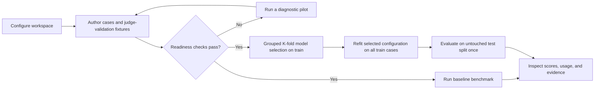

# MS Agent Eval Documentation

MS Agent Eval turns an immutable repository revision, its instructions, and a
reviewed case bank into reproducible solver evaluations and DSPy optimization
runs. The documentation is organized by the job being performed rather than by
the order in which framework components were implemented.

## End-to-end workflow

A pilot is diagnostic and never produces valid benchmark metrics. An
optimization run selects a configuration by grouped K-fold cross-validation on
training cases, refits it on all training cases, and then evaluates the untouched
test set once.

## Choose what you are trying to do

| Goal | Start here |
| --- | --- |
| Understand the required files, models, and readiness gates | [Experiment setup](experiments/index.md) |
| Create a workspace and complete the first run | [Getting started](experiments/getting-started.md) |
| Understand what “training” does and what it produces | [Training and optimization](training/index.md) |
| Build coverage, validate the judge, or interpret a run | [Evaluation](evaluation/index.md) |
| Configure an API endpoint or isolated Codex execution | [Execution](execution/index.md) |
| Understand components, storage, and security boundaries | [Architecture](architecture/index.md) |
| Look up stable rules and terminology | [Reference](reference/index.md) |

## Documentation sections

### Experiments

- [Experiment setup and requirements](experiments/index.md)
- [Getting started](experiments/getting-started.md)
- [Workspace configuration](experiments/workspace-configuration.md)
- [Case authoring](experiments/case-authoring.md)
- [Target sources and immutable snapshots](experiments/target-sources.md)
- [Running an experiment](experiments/running-an-experiment.md)

### Training and optimization

- [Training lifecycle, inputs, and outputs](training/index.md)
- [Optimization stage lifecycle](training/optimization-lifecycle.md)
- [Training data splits](training/data-splits.md)
- [Outputs and artifacts](training/outputs-and-artifacts.md)

### Evaluation

- [Evaluation workflow](evaluation/index.md)
- [Capability coverage contract](evaluation/capability-coverage.md)
- [Judging and judge validation](evaluation/judging-and-validation.md)
- [Pilot versus scored runs](evaluation/pilot-vs-scored-runs.md)
- [Interpreting results](evaluation/interpreting-results.md)

### Execution

- [Executor choices and portable stages](execution/index.md)
- [OpenAI-compatible API](execution/openai-compatible-api.md)
- [Codex CLI harness](execution/codex-cli.md)
- [Resume and recovery](execution/resume-and-recovery.md)
- [Incremental execution and cross-run reuse](execution/incremental-execution.md)

### Architecture and reference

- [Architecture overview](architecture/index.md)
- [Repository structure](architecture/repository-structure.md)
- [Storage and provenance](architecture/storage-and-provenance.md)
- [ADR-001: Portable staged execution](architecture/001-portable-staged-execution.md)
- [ADR-002: Isolated Codex CLI harness execution](architecture/002-isolated-codex-cli-execution.md)
- [ADR-003: Content-addressed experiment graph](architecture/003-content-addressed-experiment-graph.md)
- [ADR-004: Pooled endpoint concurrency](architecture/004-pooled-endpoint-concurrency.md)
- [DSPy feasibility report](architecture/dspy-feasibility-report.md)
- [Framework conventions](reference/conventions.md)
- [CLI reference](reference/cli.md)
- [Workspace schema reference](reference/workspace-schema.md)
- [Terminology](reference/terminology.md)

## Repository-specific examples

Examples demonstrate how a target repository consumes the generic framework;
they are not part of the framework contract.

- [MainSequence SDK workspace](../experiments/mainsequence-sdk/README.md)
- [Command Center SDK workspace](../experiments/command-center-sdk/README.md)

Historical implementation plans live outside this documentation tree in the
root-level `.implementation_tasks/` directory, which is local and ignored by Git. Current behavior is defined by
these guides, schema-v11 workspaces, and the repository-local case-authoring
skill.
