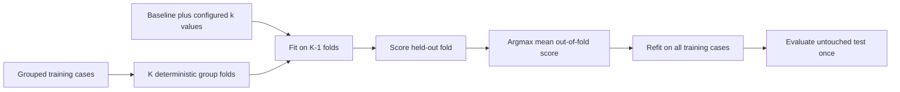

# Training and Model Selection

In MS Agent Eval, training means fitting a DSPy solver from reviewed training
cases. The framework does not update LLM weights. Its fitted output is a
content-addressed, state-only DSPy JSON artifact.

## Method



The permanent case splits are `train`, `test`, and optional `challenge`.
Cross-validation folds are derived within `train`, and all cases sharing a
leakage group stay together. Test and challenge data are unavailable during
fitting and model selection.

An optimization experiment declares the candidate hyperparameters and the
cross-validation procedure:

```yaml
optimize-few-shot:
  mode: optimize
  based_on: baseline
  optimizer:
    name: LabeledFewShot
    search:
      k: [1, 2, 4]
  cross_validation:
    folds: 5
    seed: 0
  budget:
    solver: {model_calls: 100, tokens: 250000}
    judge: {model_calls: 300, tokens: 500000}
    wall_seconds: 1800
```

The baseline (`k=0`) is always included. Selection maximizes mean out-of-fold
score. Ties prefer smaller `k`, then candidate id. There is no score cutoff.

## Outputs

The run records fold assignments, every candidate's out-of-fold scores and
mean, the selected configuration, the final fit on all training cases, the
single held-out test evaluation, model usage, and content hashes. Reports expose
continuous scores and named critical violations, not binary pass/fail fields.

See [Data splits and cross-validation](data-splits.md), the
[optimization lifecycle](optimization-lifecycle.md), and
[outputs and artifacts](outputs-and-artifacts.md).
