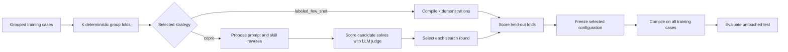

# Training and Model Selection

In MS Agent Eval, optimization compiles a model-visible DSPy solver artifact;
it does not update LLM weights. Each optimization experiment chooses exactly
one strategy, because demonstrations and instruction/skill rewrites are
different interventions.

## Method



The permanent case splits are `train`, `test`, and optional `challenge`.
Cross-validation folds are derived within `train`, and all cases sharing a
leakage group stay together. Test and challenge data are unavailable during
fitting and model selection.

For demonstration search:

```yaml
optimize-solver:
  mode: optimize
  based_on: baseline
  optimizer:
    strategy: labeled_few_shot
    search:
      k: [1, 2, 4]
  cross_validation:
    folds: 5
    seed: 0
  budget:
    solver: {model_calls: 100, tokens: 250000}
    judge: {model_calls: 300, tokens: 500000}
    wall_seconds: 1800
```

The baseline (`k=0`) is always included. The prompt and skills remain fixed and
the optimizer model is never called.

For prompt-and-skill search:

```yaml
optimize-solver:
  mode: optimize
  based_on: baseline
  optimizer:
    strategy: copro
    targets: {prompt: true, skills: all}
    search: {breadth: 3, depth: 2, init_temperature: 1.4}
    metric: {name: rubric_mean_score}
  cross_validation: {folds: 5, seed: 0}
  budget:
    optimizer: {model_calls: 100, tokens: 400000}
    solver: {model_calls: 5000, tokens: 20000000}
    judge: {model_calls: 15000, tokens: 30000000}
    wall_seconds: 14400
```

COPRO starts with the exact locked solver instruction and skill bytes. For each
target and depth round it asks the optimizer model for `breadth - 1` rewrites,
keeps the current text as a candidate, asks the solver to answer permitted
training cases, has the separate LLM judge score those responses, and selects
the highest mean score. The resulting program has zero demonstrations.

Both strategies select by mean out-of-fold score. Deterministic tie-breaking
prefers the current candidate for COPRO and smaller `k` for few-shot search.
There is no score cutoff.

## Outputs

The run records fold assignments, candidate scores, selections, the compiled
state, the held-out test evaluation, content hashes, and role-separated usage.
COPRO additionally records proposal rounds, selected solver instruction and
prefix, source/overlay skill hashes, and candidate lineage. Reports expose
continuous scores and named critical violations, not binary pass/fail fields.

See [Data splits and cross-validation](data-splits.md), the
[optimization lifecycle](optimization-lifecycle.md), and
[outputs and artifacts](outputs-and-artifacts.md).
