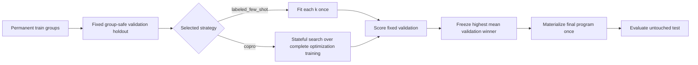

# Training and Model Selection

In MS Agent Eval, optimization compiles a model-visible DSPy solver artifact;
it does not update LLM weights. Each experiment selects one strategy because
demonstrations and instruction/skill rewrites are different interventions.

## Method



The permanent case splits are `train`, `test`, and optional `challenge`.
Validation is derived inside `train`; all cases sharing a leakage group stay
together. Test and challenge data are unavailable during fitting and selection.

For demonstration search:

```yaml
optimize-solver:
  mode: optimize
  based_on: baseline
  optimizer:
    strategy: labeled_few_shot
    search:
      k: [1, 2, 4]
  validation: {strategy: holdout, fraction: 0.2, seed: 0}
  budget:
    solver: {model_calls: 100, tokens: 250000}
    judge: {model_calls: 300, tokens: 500000}
    wall_seconds: 1800
```

The baseline (`k=0`) is always included. The prompt and skills remain fixed and
the optimizer model is never called.

For skill search with frozen global instructions:

```yaml
optimize-solver:
  mode: optimize
  based_on: baseline
  optimizer:
    strategy: copro
    search_space:
      type: skills
      include: all
    search:
      breadth: 3
      depth: 2
      init_temperature: 1.4
    metric: {name: rubric_mean_score}
  validation: {strategy: holdout, fraction: 0.2, seed: 0}
  budget:
    optimizer: {model_calls: 100, tokens: 400000}
    solver: {model_calls: 5000, tokens: 20000000}
    judge: {model_calls: 15000, tokens: 30000000}
    wall_seconds: 14400
```

COPRO starts with the locked global instructions and skill bytes. A skill search
may rewrite only the selected skills. A separate experiment can instead set
`search_space: {type: global_instructions, files: all}` to optimize one shared
global bundle while freezing every skill. Both modes freeze the DSPy signature
and response contract; there is no joint search. For each target and depth round
the optimizer proposes `breadth - 1` rewrites, keeps the current text as a
candidate, and selects by fixed-validation LLM-judge score. Winning state and
scored history carry into the next round. There is no
fold reset and no extra final search. The final program has zero demonstrations.

Both strategies select by mean validation score. Deterministic tie-breaking
prefers the current candidate for COPRO and smaller `k` for few-shot search.
There is no score cutoff.

## Outputs

The run records the validation assignment, candidate
scores and selections, compiled state, untouched test evaluation,
content-addressed reuse, and role-separated usage. COPRO additionally records
its search-space type, proposal rounds, frozen/effective global hashes,
source/overlay skill hashes, and candidate lineage. Reports expose continuous
scores and named critical
violations, not binary pass/fail fields.

See [Data splits and validation](data-splits.md), the
[optimization lifecycle](optimization-lifecycle.md),
[outputs and artifacts](outputs-and-artifacts.md), and
[ADR-011](../architecture/011-stateful-optimization-and-semantic-reuse.md), and
[ADR-012](../architecture/012-factorized-copro-optimization-scopes.md).
