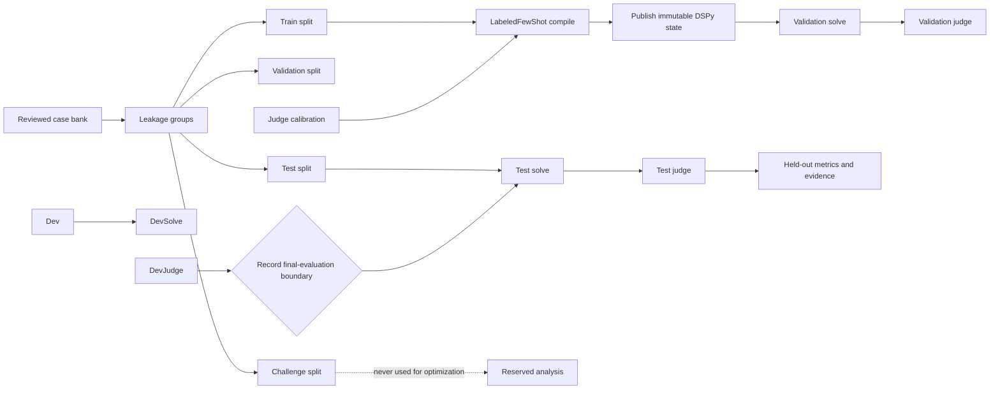

# Training and Optimization

In MS Agent Eval, “training” means compiling a DSPy solver program from reviewed
train cases. The current framework does not update model weights and does not
produce a fine-tuned model. Its primary training output is a content-addressed,
state-only DSPy JSON artifact.

## Split and lifecycle boundaries



Leakage groups, rather than individual prompts, are assigned to splits. Examples
derived from the same source, defect, design, or likely solution remain in one
group so near-duplicates cannot cross the training boundary.

## Inputs

An optimization experiment requires:

| Input | Purpose |
| --- | --- |
| A baseline experiment | Defines the typed DSPy solver, runtime, and ordinary evaluation behavior. |
| Reviewed train cases | Supply tasks and expected responses used by `LabeledFewShot`. |
| Validation cases | Measure the compiled candidate before held-out evaluation. |
| Untouched test cases | Produce the final comparable result after publication. |
| A calibrated judge | Scores validation and test responses with the locked correctness contract. |
| Optimizer configuration | Selects `LabeledFewShot` parameters such as `k` and `seed`. |
| Solver/judge budgets | Bound calls, tokens, and wall-clock time. |

The workspace shape is:

```yaml
experiments:
  baseline:
    mode: evaluate
    solver:
      dspy:
        module: Predict
        signature:
          inputs: {global_context: str, skill_context: str, task: str}
          outputs: {response: str}
    runtime: {type: response_only, python: "3.12"}

  optimize-few-shot:
    mode: optimize
    based_on: baseline
    dataset:
      train: train
      validation: validation
      final_evaluation: test
    optimizer:
      name: LabeledFewShot
      parameters: {k: 2, seed: 0}
    output:
      compiled_program: content_addressed_json
```

## What happens during an optimization run

1. The framework locks the repository snapshot, case bytes, grouped splits,
   authoring policy, capability catalog, model identities, judge program, and
   calibration corpus.
2. Judge calibration runs before any solver request. A failed calibration stops
   the run.
3. `LabeledFewShot` compiles demonstrations from train cases and publishes
   state-only JSON; pickle and unsafe LM state are not accepted.
4. The compiled solver answers validation cases and the calibrated judge scores
   those responses.
5. A final-evaluation packet records the compiled artifact and validation
   judgments before the test assignment is opened.
6. The same compiled solver answers test cases. The judge scores them without
   exposing rubrics or expected responses to the solver.
7. Aggregation emits held-out scores, pass rates, model usage, and artifact
   identities.
8. Finalization collects unreachable internal artifacts and deterministically
   publishes Markdown, CSV, JSON, and per-case reports without an LLM call.

## Outputs

Machine-oriented outputs are stored below `workspace.data_root/operations` or
the default `~/ms_agent_eval/<workspace-id>/operations`. Human-readable derived
outputs are published automatically below `summary/runs/<run-id>/`.

| Output | Meaning |
| --- | --- |
| Compiled state artifact | Safe JSON state needed to reconstruct the optimized DSPy solver. |
| Compiled program hash | Stable identity of the published candidate. |
| Train-case hash | Identity of the exact cases used for compilation. |
| Validation-assignment hash | Identity of the validation set used before final evaluation. |
| Test-assignment hash | Identity of the held-out assignment opened after publication. |
| Stage packets and results | Append-only evidence for calibration, solve, judge, optimization, final evaluation, and aggregation. |
| Model-call evidence | Rendered requests, responses, usage, latency, model identity, and parameters. |
| Run summary | Per-case results plus benchmark mean score and pass rate. |

## What training does not produce

- It does not modify the underlying LLM or create model weights.
- It does not use test or challenge prompts, answers, responses, or judge
  feedback as training data.
- It does not make pilot output a benchmark; optimization cannot run in pilot
  mode.
- It does not make incompatible runs comparable. Changes to the source, cases,
  splits, judge, or calibration produce a different locked evaluation identity.

Run the optimization with:

```bash
uv run ms-agent-eval run optimize-few-shot --workspace workspace.yaml
```

See [Evaluation](../evaluation/index.md) for readiness and scoring, and
[Architecture](../architecture/index.md) for persistence and stage boundaries.
Detailed references cover the [optimization lifecycle](optimization-lifecycle.md),
[data splits](data-splits.md), [outputs and artifacts](outputs-and-artifacts.md),
and [candidate publication](promotion.md).
