# Optimization Lifecycle

An optimization experiment performs model selection with grouped K-fold
cross-validation and then evaluates the selected configuration on the untouched
test set:

```mermaid
flowchart LR
    Lock[Lock experiment] --> ValidateJudge[Validate judge ordering]
    ValidateJudge --> Folds[Assign training leakage groups to K folds]
    Folds --> Strategy{Selected strategy}
    Strategy -->|labeled_few_shot| FitCV[Fit each k on K-1 folds]
    Strategy -->|copro| Propose[Propose prompt or skill candidates]
    Propose --> CandidateSolve[Solver answers fitting cases]
    CandidateSolve --> CandidateJudge[LLM judge scores candidates]
    CandidateJudge --> RoundSelect[Select round winner]
    RoundSelect --> FitCV
    FitCV --> ScoreCV[Score each held-out fold]
    ScoreCV --> Select[Select highest mean out-of-fold score]
    Select --> Refit[Refit selected configuration on all training cases]
    Refit --> Test{Final test strategy}
    Test -->|labeled_few_shot| Selected[Evaluate selected program]
    Test -->|copro| Original[Evaluate original program]
    Test -->|copro| Optimized[Evaluate frozen optimized program]
    Selected --> Aggregate[Aggregate continuous test scores]
    Original --> Pair[Pair identical test cases]
    Optimized --> Pair
    Pair --> Aggregate
```



With `labeled_few_shot`, the candidate set contains the unfitted baseline
(`k=0`) and every configured positive `k`. The instruction, prefix, and skills
are fixed.

With `copro`, each proposal packet handles one target and one round. The
original/current text is always a candidate alongside `breadth - 1` optimizer
proposals. Candidate solves and LLM judgments are ordinary content-addressed
stage nodes; deterministic selection feeds the next target or round. Skill
rewrites become compiled overlays and never modify the source skill. The final
program contains no demonstrations.

Execution follows ready DAG edges rather than a solve-wide then judge-wide
barrier. As soon as one candidate solve persists, its judge packet becomes
eligible and receives priority in the shared endpoint-capacity scheduler; the
coordinator does not wait for every candidate solve. The global prompt is
selected first in each round. Its resulting bundle is frozen while all
eligible skill targets propose, solve, and judge candidates through the same
bounded work queues. Each skill winner contributes only its own overlay to the
merged bundle, so independent skill selections cannot overwrite one another.

```text
global prompt proposal -> solve -> judge -> select -> frozen prompt
                                                     |
                   +---------------------------------+------------------+
                   |                                 |                  |
             skill A solve                     skill B solve      skill C solve
                   |                                 |                  |
             skill A judge                     skill B judge      skill C judge
                   |                                 |                  |
                   +---------------- merge selected overlays ----------+
```

COPRO proposal breadth is a maximum, not a reason to invalidate a run. Model
output is normalized in return order: unchanged proposals, repeated proposals,
and proposals beyond the configured breadth are removed. A round continues
with the current candidate plus every distinct accepted proposal, including
the current candidate alone if the model produced no useful alternative.
Structural errors such as a missing instruction, an unknown field, or an empty
solver response prefix still fail the stage.

Every new proposal result records `proposal_accounting` with requested,
received, accepted, unchanged, duplicate, excess, and shortfall counts plus a
`degraded` flag. The same accounting is carried into deterministic selection,
the compiled candidate lineage, and the run report. It distinguishes valid
search-space exhaustion from transport, parsing, and integrity failures.

Runs created before this policy keep their immutable failed attempts. On
`run resume`, a historical failure caused specifically by duplicate, unchanged,
or under-count COPRO proposals receives a new append-only attempt under the
same work identity. Previously persisted fit, solve, judge, and selection nodes
remain eligible for content-addressed reuse; they are not deleted or rewritten.

There is no acceptance cutoff. Selection is a relative comparison of mean
scores. Few-shot ties prefer smaller `k`; COPRO ties prefer the current text,
then shorter normalized text, then candidate id.

The test set is not a gate and does not affect selection. It provides the final
held-out estimate for the already-selected configuration. COPRO additionally
runs the original zero-shot program on the same locked test cases and reports
paired optimization deltas; neither arm can affect selection. Every optimizer
proposal, fit, solve, judge, selection, and aggregate result remains
content-addressed and auditable. Optimizer packets cannot contain rubrics,
expected answers, judge feedback, or held-out data.

See [Formal COPRO summary](../evaluation/formal-copro-summary.md) for paired
statistics, exact expected-response token bands, and report assets.
