# Optimization Lifecycle

An optimization experiment selects against one fixed validation holdout derived
from permanent train, freezes the winner, and evaluates it on untouched test:

```mermaid
flowchart LR
    Lock[Lock experiment] --> ValidateJudge[Validate judge once]
    ValidateJudge --> Holdout[Derive fixed group-safe validation]
    Holdout --> Strategy{Selected strategy}
    Strategy -->|labeled_few_shot| FitK[Fit every k once]
    Strategy -->|copro| P1[Search training partition 1]
    P1 -->|winner + history| PN[Search next partition]
    FitK --> Score[Score fixed validation]
    Holdout --> Score
    PN --> Score
    Score --> Select[Freeze highest mean validation winner]
    Select --> Materialize[Materialize final program once]
    Materialize --> Test{Final test strategy}
    Test -->|labeled_few_shot| Selected[Evaluate selected program]
    Test -->|copro| Original[Evaluate original program]
    Test -->|copro| Optimized[Evaluate frozen optimized program]
    Selected --> Aggregate[Aggregate continuous test scores]
    Original --> Pair[Pair identical test cases]
    Optimized --> Pair --> Aggregate
```



With `labeled_few_shot`, the candidate set contains the unfitted baseline
(`k=0`) and every configured positive `k`. The instruction, prefix, and skills
are fixed.

With `copro`, each proposal packet handles one target and round. The
original/current text remains a candidate alongside `breadth - 1` optimizer
proposals. Candidate solves and LLM judgments are content-addressed stage
nodes; deterministic selection feeds the next target, round, and training
partition. The winner and numeric candidate history are never discarded at a
partition boundary. Skill rewrites become compiled overlays and never modify
the source skill. The final program contains no demonstrations.

Execution follows ready DAG edges rather than a solve-wide then judge-wide
barrier. As soon as one candidate solve persists, its judge packet becomes
eligible and receives priority in the shared endpoint-capacity scheduler; the
coordinator does not wait for every candidate solve. The global prompt is
selected first in each round. Its resulting bundle is frozen while all
eligible skill targets propose, solve, and judge candidates through the same
bounded work queues. Each skill winner contributes only its own overlay to the
merged bundle, so independent skill selections cannot overwrite one another.

```text
global prompt proposal -> solve -> judge -> select -> frozen prompt
                                                     |
                   +---------------------------------+------------------+
                   |                                 |                  |
             skill A solve                     skill B solve      skill C solve
                   |                                 |                  |
             skill A judge                     skill B judge      skill C judge
                   |                                 |                  |
                   +---------------- merge selected overlays ----------+
```

COPRO proposal breadth is a maximum. Output is normalized in return order:
unchanged, duplicate, and excess proposals are removed. A round continues with
the current candidate plus every distinct accepted proposal, including only
the current candidate if no useful alternative remains. Structural errors such
as a missing instruction, unknown field, or empty solver response prefix still
fail the stage.

Each proposal result records `proposal_accounting` with requested, received,
accepted, unchanged, duplicate, excess, and shortfall counts plus a `degraded`
flag. The accounting flows into selection, candidate lineage, and reports.

There is no acceptance cutoff. Selection compares mean validation score.
Few-shot ties prefer smaller `k`; COPRO ties prefer current text, then shorter
normalized text, then candidate id. Test is not a gate and cannot affect
selection. COPRO runs original and optimized zero-shot programs on identical
test cases and reports paired deltas.

Model calls are reused by semantic identity. Phase, partition, round, producer
packet, and run placement stay in attempt provenance but do not force a new
call when the exact model-visible request, model, parameters, and relevant
artifacts are unchanged. Reused outputs are rebound to their current reporting
coordinates while retaining source-result provenance.

No proposal, fit, validation selection, or optimizer packet may contain
rubrics, expected answers, judge feedback, test, or challenge data. See
[ADR-011](../architecture/011-stateful-optimization-and-semantic-reuse.md) for
the complete state, hashing, and migration contract.
