# Optimization Lifecycle

An optimization experiment runs these stages in order:

```mermaid
flowchart LR
    Lock[Lock experiment] --> Calibrate[Calibrate judge]
    Calibrate --> Optimize[Compile train demonstrations]
    Optimize --> State[Persist state-only JSON]
    State --> ValidationSolve[Solve validation]
    ValidationSolve --> ValidationJudge[Judge validation]
    ValidationJudge --> Final[Record final-evaluation packet]
    Final --> TestSolve[Solve test]
    TestSolve --> TestJudge[Judge test]
    TestJudge --> Aggregate[Aggregate held-out result]
```

`LabeledFewShot` samples reviewed train examples using the configured `k` and
`seed`. Compilation is deterministic with respect to its locked inputs and
records the train-case hash. The resulting program state is persisted before
validation requests begin.

Validation scores are evidence about the fixed candidate. The framework does
not feed validation judge feedback back into the candidate during the same
run. After validation judgments persist, the final-evaluation packet records
the boundary that allows the untouched test assignment to be loaded.

Every stage has an outer model-call, token, and wall-time budget independent of
optimizer parameters. Exceeding a budget fails the stage without silently
continuing or changing the candidate.

See [Data splits](data-splits.md) for visibility rules and
[Outputs and artifacts](outputs-and-artifacts.md) for persisted evidence.
