# Optimization Lifecycle

An optimization experiment performs model selection with grouped K-fold
cross-validation and then evaluates the selected configuration on the untouched
test set:

```mermaid
flowchart LR
    Lock[Lock experiment] --> ValidateJudge[Validate judge ordering]
    ValidateJudge --> Folds[Assign training leakage groups to K folds]
    Folds --> FitCV[Fit every candidate on K-1 folds]
    FitCV --> ScoreCV[Score each held-out fold]
    ScoreCV --> Select[Select highest mean out-of-fold score]
    Select --> Refit[Refit selected configuration on all training cases]
    Refit --> Test[Evaluate test once]
    Test --> Aggregate[Aggregate continuous test scores]
```

The candidate set contains the unfitted baseline (`k=0`) and every configured
`LabeledFewShot` value. There is no acceptance cutoff. Selection is a relative
comparison of out-of-fold mean scores, with deterministic tie-breaking by
smaller `k` and then candidate id.

The test set is not a gate and does not affect selection. It provides the final
held-out estimate for the already-selected configuration. Every fit, solve,
judge, selection, and aggregate result remains content-addressed and auditable.
