# Optimization Lifecycle

An optimization experiment selects against one fixed validation holdout derived
from permanent train, freezes the winner, and evaluates it on untouched test:

```mermaid
flowchart LR
    Lock[Lock experiment] --> ValidateJudge[Validate judge once]
    ValidateJudge --> Holdout[Derive fixed group-safe validation]
    Holdout --> Strategy{Selected strategy}
    Strategy -->|labeled_few_shot| FitK[Fit every k once]
    Strategy -->|copro| R1[Search round 1]
    R1 -->|winner + history| RN[Search next configured round]
    FitK --> Score[Score fixed validation]
    Holdout --> Score
    RN --> Score
    Score --> Select[Freeze highest mean validation winner]
    Select --> Materialize[Materialize final program once]
    Materialize --> Test{Final test strategy}
    Test -->|labeled_few_shot| Selected[Evaluate selected program]
    Test -->|copro| Original[Evaluate original program]
    Test -->|copro| Optimized[Evaluate frozen optimized program]
    Selected --> Aggregate[Aggregate continuous test scores]
    Original --> Pair[Pair identical test cases]
    Optimized --> Pair --> Aggregate
```



With `labeled_few_shot`, the candidate set contains the unfitted baseline
(`k=0`) and every configured positive `k`. The instruction, prefix, and skills
are fixed.

With `copro`, the workspace chooses exactly one factorized search space:

- `skills` freezes every global instruction and searches independent overlays
  for the selected skills; or
- `global_instructions` freezes every skill and searches one shared global
  instruction bundle.

Both modes freeze the DSPy signature instruction and response contract. Each
proposal packet handles one target and round. The original/current text remains
a candidate alongside `breadth - 1` optimizer proposals. Candidate solves and
LLM judgments are content-addressed stage nodes; deterministic selection feeds
the next round. Winners and numeric candidate history are never discarded at
an artificial corpus boundary. Source instruction files are
never modified, and the final program contains no demonstrations.

Execution follows ready DAG edges rather than a solve-wide then judge-wide
barrier. As soon as one candidate solve persists, its judge packet becomes
eligible and receives priority in the shared endpoint-capacity scheduler; the
coordinator does not wait for every candidate solve. In skill mode, eligible
skills propose, solve, and judge candidates through the same bounded work
queues. Each winner contributes only its own overlay to the merged skill bank,
so independent skill selections cannot overwrite one another. In global mode,
one global target is scored across the complete affected validation corpus.

```text
skill mode                                global-instruction mode

frozen AGENTS.md                          frozen skill bank
      |                                         |
  +---+---+                                global proposal
  |       |                                      |
skill A skill B                           solve all validation
  |       |                                      |
judge A judge B                                 judge
  |       |                                      |
  +-- merge overlays                       select one bundle
```

COPRO proposal breadth is a maximum. Output is normalized in return order:
malformed, unchanged, duplicate, and excess proposals are removed. A round
continues with the current candidate plus every distinct accepted proposal,
including only the current candidate if no useful alternative remains. A
malformed proposal is never repaired: an unknown field, missing instruction,
or invalid field type discards that candidate alone. The outer model envelope
(`candidates` must be a list) remains strict and fails the stage when invalid.

Each proposal result records `proposal_accounting` with requested, received,
accepted, malformed, unchanged, duplicate, excess, and shortfall counts plus
a `degraded` flag. The accounting flows into selection, candidate lineage, and
reports.

The next round receives the selected winner as `current_text` and complete
candidate bodies in `scored_attempts`. Each scored attempt also carries exact
per-case validation outcomes: overall score, criterion scores, hard failures,
and judge feedback. This is the evidence COPRO uses to understand what succeeded
and what failed.

Before dispatch, exact endpoint tokenization checks the full rendered request
and reserves estimated completion space for every requested complete rewrite.
The reserve does not impose a model output limit. If the complete request cannot
fit any eligible context, the coordinator automatically creates a distinct
`structural_delta_v1` retry for that target. It keeps the winner in full and all
validation outcomes, replacing only non-selected bodies with changed headings
and representative edit hunks. If that still cannot fit, the stage fails; it
does not silently discard failure evidence. That failure is local to the COPRO
target: the coordinator retains the frozen source text for that target, records
the reason in the final program lineage and report, and continues optimizing
the remaining independent targets. It never converts the partial optimization
into an invented successful rewrite. The same target-local rule applies if its
candidate fit, validation solve, validation judgment, or deterministic
selection fails. The report identifies the skill, round, failed stage, and
backend error.

Token counts are provenance and reporting data, not an internal execution
ceiling. A response that needs 35,281 tokens is retained as a valid response
when the endpoint accepts it. The real request boundary is the endpoint's
context window; a request that cannot fit is reported against the affected
target as described above.

There is no acceptance cutoff. Selection compares mean validation score.
Few-shot ties prefer smaller `k`; COPRO ties prefer current text, then shorter
normalized text, then candidate id. Test is not a gate and cannot affect
selection. COPRO runs original and optimized zero-shot programs on identical
test cases and reports paired deltas.

Model calls are reused by semantic identity. Phase, round, producer
packet, and run placement stay in attempt provenance but do not force a new
call when the exact model-visible request, model, parameters, and relevant
artifacts are unchanged. Reused outputs are rebound to their current reporting
coordinates while retaining source-result provenance.

No proposal, fit, validation selection, or optimizer packet may contain
rubrics, expected answers, judge feedback, test, or challenge data. See
[ADR-011](../architecture/011-stateful-optimization-and-semantic-reuse.md) for
the state and semantic-reuse contract and
[ADR-012](../architecture/012-factorized-copro-optimization-scopes.md) for the
factorized search-space and frozen-layer contract.
