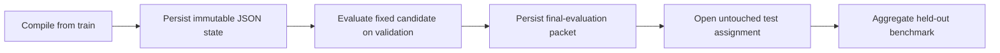

# Candidate Publication and Final Evaluation

The framework does not currently have a manual promotion command. The
optimization stage publishes a content-addressed, state-only DSPy candidate;
the run then evaluates that fixed candidate on validation before recording a
separate final-evaluation packet that permits test access.

Publication guarantees that later validation or test feedback cannot mutate
the candidate inside the same run. The final-evaluation packet binds the
compiled packet, validation judgments, and test assignment hash.

Teams may add an external human approval policy between completed validation
evidence and a separate production decision, but that policy is not implemented
as an MS Agent Eval stage and must not be confused with the framework's
automatic artifact publication.

A published state is reusable only with the solver program shape that produced
it. Any comparison still requires compatible source, cases, splits, judge,
calibration, runtime, and experiment identities.
